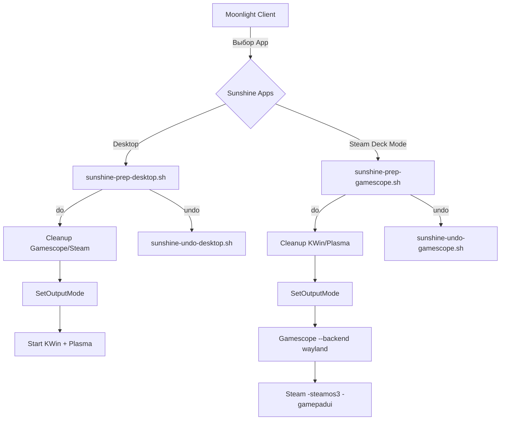

# Анализ Cloud Desktop Host — Deck Mode

Глубокий разбор проекта `/root/cloud-desktop-host` с фокусом на запуск в режиме **Steam Deck Mode** (GamepadUI / `-steamos3`).

---

## 1. Обзор архитектуры CDH

**Cloud Desktop Host (CDH)** — headless Wayland-композитор на базе wlroots, работающий как **system compositor** в LXC контейнере с NVIDIA GPU. Его задача — предоставить виртуальный экран для вложенного приложения (KWin или Gamescope) и транслировать кадры через Sunshine → Moonlight.

```
┌─────────────────────────────────────────────────────────────┐
│  LXC Container 120 (fedora07)                               │
│                                                             │
│  ┌─── CDH (cloud-desktop-host) ─── headless compositor ──┐  │
│  │  wayland-cd socket                                     │  │
│  │  20 Wayland protocols (xdg, dmabuf, screencopy...)     │  │
│  │  D-Bus: org.gamescope.Input                            │  │
│  │  PID filter → xdg_wm_base видимость                   │  │
│  └───────────────┬───────────────────────────────────────┘  │
│                  │                                           │
│         ┌────────┴────────┐                                  │
│         │   Desktop mode  │    ← wayland-cd клиент           │
│         │   (KWin/Plasma) │                                  │
│         └─────────────────┘                                  │
│                 OR                                            │
│         ┌────────┴──────────────────────────────────┐        │
│         │   Deck mode (вариант A — standalone)      │        │
│         │   Xwayland → Steam -gamepadui             │        │
│         └───────────────────────────────────────────┘        │
│                 OR                                            │
│         ┌────────┴──────────────────────────────────┐        │
│         │   Deck mode (вариант B — nested)          │        │
│         │   Gamescope (wayland backend) →            │        │
│         │     → Xwayland → Steam -steamos3           │        │
│         └───────────────────────────────────────────┘        │
│                                                             │
│  ┌── Sunshine ──────────────────────────────────────────┐   │
│  │  wlr_screencopy → NVENC → Moonlight                  │   │
│  └──────────────────────────────────────────────────────┘   │
└─────────────────────────────────────────────────────────────┘
```

---

## 2. Два пути запуска Deck Mode

Проект реализует **два принципиально разных** пути для запуска Steam GamepadUI:

### 2A. Standalone режим (`run-steam.sh`)

| Параметр | Значение |
|---|---|
| **Скрипт** | [run-steam.sh](file:///root/cloud-desktop-host/scripts/run-steam.sh) |
| **Стек** | `CDH → Xwayland (fullscreen) → Steam -gamepadui` |
| **KWin** | ❌ Не используется |
| **Gamescope** | ❌ Не используется |
| **Steam флаг** | `-gamepadui -noverifyfiles` (без `-steamos3`) |
| **DISPLAY** | `:0` (Xwayland создаёт X11 display) |
| **CDH аргументы** | `--no-auto-lock` |
| **Назначение** | Тестирование / лёгкий standalone режим |

**Стек запуска:**
```
1. D-Bus session bus
2. PipeWire → WirePlumber → PipeWire-Pulse
3. kactivitymanagerd (offscreen)
4. CDH с --no-auto-lock
5. Xwayland fullscreen → подключается к wayland-cd
6. Steam -gamepadui через X11
7. Sunshine → screencopy wayland-cd
```

> [!WARNING]
> В standalone режиме **нет** `-steamos3` — Steam не получает полный SteamOS code path. Это означает:
> - Нет Performance overlay через QAM
> - Нет Dynamic FPS Limiter
> - Нет MangoHud/MangoApp интеграции

---

### 2B. Nested Gamescope режим (`sunshine-prep-gamescope.sh`)

| Параметр | Значение |
|---|---|
| **Скрипт** | [sunshine-prep-gamescope.sh](file:///root/cloud-desktop-host/scripts/sunshine-prep-gamescope.sh) |
| **Стек** | `CDH → Gamescope (wayland) → Xwayland × 2 → Steam -steamos3` |
| **KWin** | ❌ Убивается при переключении |
| **Gamescope** | ✅ Как вложенный compositor |
| **Steam флаг** | `-steamos3 -gamepadui -noverifyfiles` |
| **Sunshine App** | `"Steam Deck Mode"` в [apps.json](file:///root/cloud-desktop-host/configs/sunshine/apps.json) |
| **CDH аргументы** | Без специальных (CDH не знает что запущен Gamescope) |
| **Назначение** | **Production режим** — полная эмуляция Steam Deck |

**Стек запуска:**
```
1. Cleanup: убить KWin, Plasma, Steam, Gamescope, Xwayland
2. D-Bus SetOutputMode → CDH (подстройка под Moonlight resolution)
3. MangoHud config (readonly, без no_display)
4. Gamescope:
   --backend wayland        ← подключается к wayland-cd
   -W/-H/-w/-h/-r           ← разрешение от Sunshine
   -e --mangoapp            ← MangoHud + Performance overlay
   --xwayland-count 2       ← 2 Xwayland (game + Steam shell)
   --force-grab-cursor      ← cursor capture
   -f                       ← fullscreen
   STEAM_DECK=1             ← эмулировать Steam Deck
5. Steam -steamos3 -gamepadui (дочерний процесс Gamescope)
```

---

## 3. Ключевые механизмы CDH для Deck Mode

### 3.1 PID-фильтр в `protocols.cpp`

[protocols.cpp:73-84](file:///root/cloud-desktop-host/src/protocols.cpp#L73-L84) — **глобальный фильтр** контролирует, какой клиент видит `xdg_wm_base`:

```cpp
static bool global_filter_cb(...) {
    if (global == server->xdg_shell_global) {
        auto *nc_client = const_cast<struct wl_client*>(client);
        return is_gamescope_client(nc_client) ||
               (server->no_auto_lock
                ? is_xwayland_client(nc_client)
                : is_kwin_client(nc_client));
    }
    return true; // все остальные протоколы видимы всем
}
```

| Режим | `no_auto_lock` | `xdg_wm_base` виден для |
|---|---|---|
| Desktop (KWin) | `false` | `kwin_wayland` и `gamescope` |
| Standalone Steam | `true` | `Xwayland` и `gamescope` |
| Nested Gamescope | `false` | `kwin_wayland` и `gamescope` ← **Gamescope подхватывает!** |

> [!IMPORTANT]
> В nested режиме CDH **не знает** что это deck mode. Для CDH это просто ещё один Wayland-клиент с `comm == "gamescope"`. PID-фильтр **всегда** пропускает gamescope.

### 3.2 XDG Toplevel lifecycle (`xdg.cpp`)

[xdg.cpp:246-276](file:///root/cloud-desktop-host/src/xdg.cpp#L246-L276) — CDH принимает **первый** xdg_toplevel как `desktop_surface`:

```cpp
if (server->desktop_toplevel == nullptr) {
    server->desktop_toplevel = toplevel;
    // ... подписка на map/unmap/destroy/commit
} else {
    // Все последующие — игнорируются
    wlr_xdg_toplevel_set_size(toplevel, 0, 0);
}
```

Для **Gamescope nested**: Gamescope создаёт один XDG toplevel через wayland backend → CDH рендерит его как desktop_surface.

Для **Standalone Steam**: Xwayland создаёт fullscreen toplevel → аналогично.

### 3.3 `--no-auto-lock` и pointer management

[xdg.cpp:106-139](file:///root/cloud-desktop-host/src/xdg.cpp#L106-L139) — При маппинге desktop surface:

- **Desktop mode**: Через 200ms посылает виртуальный RCTRL → KWin активирует `pointer lock` → курсор рисуется в кадре KWin → виден в стриме.
- **Standalone Steam** (`--no-auto-lock`): RCTRL **не отправляется** — Steam сам управляет курсором.
- **Nested Gamescope**: RCTRL **не отправляется** (отдельная проверка `comm == "gamescope"` — Gamescope скрывает курсор при `m_bPointerLocked=true`).

```cpp
bool skip_auto_lock = server->no_auto_lock;
if (!skip_auto_lock) {
    // Проверяем comm клиента — gamescope не нуждается в pointer lock
    if (strcmp(comm, "gamescope") == 0) {
        skip_auto_lock = true;
    }
}
```

### 3.4 D-Bus `SetOutputMode` и динамическое разрешение

[dbus_input.cpp:504-576](file:///root/cloud-desktop-host/src/dbus_input.cpp#L504-L576) — Sunshine вызывает `SetOutputMode(width, height, fps)` через D-Bus перед стартом Gamescope:

```
busctl --user call org.gamescope.Input /org/gamescope/Input \
    org.gamescope.InputDeviceManager SetOutputMode uuu \
    $W $H $R
```

Это обновляет:
1. `wlr_output` — custom mode
2. `server->cur_width/height/refresh`
3. `xdg_toplevel` resize + fullscreen

Gamescope получает правильный размер через XDG configure **до** начала рендеринга.

### 3.5 MangoHud/MangoApp Workaround

[sunshine-prep-gamescope.sh:74-91](file:///root/cloud-desktop-host/scripts/sunshine-prep-gamescope.sh#L74-L91) — Критический workaround для MangoHud 0.8+:

```bash
MANGOHUD_CFG="/tmp/mangohud-gamescope.conf"
cat > "$MANGOHUD_CFG" << 'EOF'
control=mangohud
EOF
chmod 444 "$MANGOHUD_CFG"  # READ-ONLY!
```

**Проблема**: Steam в режиме `-steamos3` дописывает `no_display` в MANGOHUD_CONFIGFILE. В MangoHud 0.8+ опция `no_display` удалена, но её наличие блокирует overlay-окно MangoApp → вкладка Performance в QAM не работает.

**Решение**: Создать конфиг заранее с `chmod 444` → Steam не может дописать `no_display`.

---

## 4. Переключение между режимами

Конфигурация Sunshine в [apps.json](file:///root/cloud-desktop-host/configs/sunshine/apps.json):



> [!CAUTION]
> Переключение **разрушительное** — каждый prep-cmd убивает все процессы предыдущего режима. CDH при этом **не перезагружается** — только меняется `desktop_toplevel`.

---

## 5. Поток данных в Deck Mode (Nested Gamescope)

```
Steam (X11) → Xwayland → Gamescope (Vulkan compose)
                                    ↓
                              wl_surface.commit
                                    ↓
                     CDH (XDG toplevel = Gamescope window)
                                    ↓
                           wlr_screencopy → Sunshine
                                    ↓
                              NVENC → Moonlight
```

| Этап | Протокол/Механизм | Файл CDH |
|---|---|---|
| Gamescope → CDH | `xdg_wm_base`, `zwp_linux_dmabuf_v1` | `xdg.cpp`, `protocols.cpp` |
| Commit → Render | `desktop_commit` → `schedule_frame` | `xdg.cpp:55-68` |
| Render → Output | `handle_output_frame` | `output.cpp:75-189` |
| Feedback → Gamescope | `wp_presentation`, `frame_done` | `output.cpp:128-168` |
| Sunshine → CDH | `wlr_screencopy_v1` | `protocols.cpp:127` |
| Moonlight → CDH | D-Bus `SetOutputMode(w,h,fps)` | `dbus_input.cpp:504` |

---

## 6. Критические отличия Desktop vs Deck Mode

| Аспект | Desktop | Deck Mode (nested) |
|---|---|---|
| **desktop_surface** | KWin рендерит весь desktop | Gamescope рендерит composed frame |
| **XDG клиент** | `kwin_wayland` (PID filter) | `gamescope` (PID filter) |
| **Pointer lock** | Авто-RCTRL через 200ms | Пропускается (gamescope сам управляет) |
| **Frame pipeline** | KWin commit → CDH render | Gamescope Vulkan → DMA-BUF → CDH render |
| **Presentation timing** | CDH → KWin → игры | CDH → Gamescope → Xwayland → игры |
| **Audio** | PipeWire-Pulse → Sunshine | PipeWire-Pulse → Sunshine (тот же путь) |
| **MangoHud** | Не нужен | MangoApp + `--mangoapp` + `-e` |
| **Steam env** | Через KWin/Plasma | `STEAM_DECK=1`, `-steamos3` |
| **Cursor** | KWin locks pointer → рисует сам | Gamescope `--force-grab-cursor` |
| **SetOutputMode** | Через `sunshine-prep-cmd.sh` | Через `sunshine-prep-gamescope.sh` |

---

## 7. Обнаруженные особенности и потенциальные проблемы

### 7.1 CDH не различает Desktop и Deck Mode на уровне кода

CDH не имеет внутреннего понятия «режим». Единственный переключатель — `--no-auto-lock`:
- В standalone Steam (`run-steam.sh`) он **активен** → PID-фильтр пропускает Xwayland
- В nested Gamescope (`sunshine-prep-gamescope.sh`) он **не активен**, но PID-фильтр всегда пропускает `gamescope`

Это значит что CDH **статически сконфигурирован при запуске** и не может менять PID-фильтр на лету.

### 7.2 Проблема перезапуска desktop_toplevel

При переключении Desktop → Deck Mode:
1. `sunshine-prep-gamescope.sh` убивает `kwin_wayland`
2. CDH получает `desktop_destroy` → сбрасывает `desktop_toplevel = nullptr`
3. Gamescope подключается → создаёт новый toplevel → CDH принимает его

Этот механизм **работает** благодаря тому, что `handle_desktop_destroy` полностью очищает состояние:
```cpp
server->pointer_lock_sent = false;
server->desktop_surface = nullptr;
server->desktop_toplevel = nullptr;
```

### 7.3 Heartbeat timer и idle

[main.cpp:20-32](file:///root/cloud-desktop-host/src/main.cpp#L20-L32) — HUD timer каждые 500ms принудительно вызывает `schedule_frame`. Это критично для Gamescope: если Gamescope не присылает коммиты (idle, loading screen), Sunshine не получит `frame_done` и может отвалиться по таймауту.

### 7.4 `frame_done` отправляется после commit

[output.cpp:164-169](file:///root/cloud-desktop-host/src/output.cpp#L164-L169) — CDH отправляет `frame_done` **после** `wlr_output_commit_state`. Для Gamescope это означает, что timing pipeline работает корректно: Gamescope не начнёт новый кадр, пока CDH не завершит текущий.

### 7.5 Presentation refresh fixup для Gamescope

[output.cpp:60-72](file:///root/cloud-desktop-host/src/output.cpp#L60-L72) — Headless backend отправляет `refresh=0` в present event. CDH перехватывает это и подставляет правильный refresh из `cur_refresh`. Gamescope использует это значение для Render Loop timing → **без фикса** Gamescope будет считать, что FPS = 0.

### 7.6 Отсутствие gamepad forwarding

`input.cpp` обрабатывает только **pointer** и **keyboard** через libinput. Геймпад ввод в Deck Mode работает через:
- Steam Input → Steam получает gamepad через `/dev/input/` напрямую
- Gamescope не проксирует gamepad через Wayland seat

CDH **не пробрасывает** gamepad события — это не его задача в текущей архитектуре.

---

## 8. Файловая карта Deck Mode

```
cloud-desktop-host/
├── src/
│   ├── main.cpp              ← --no-auto-lock парсинг
│   ├── server.h              ← cd_server.no_auto_lock
│   ├── protocols.cpp         ← PID-фильтр (gamescope/Xwayland/kwin)
│   ├── xdg.cpp               ← desktop_toplevel lifecycle + auto-lock skip
│   ├── output.cpp            ← heartbeat, refresh fixup, frame pipeline
│   ├── input.cpp             ← libinput → wlr_seat (pointer/keyboard only)
│   ├── dbus_input.cpp        ← SetOutputMode D-Bus
│   └── debug_ui.cpp          ← HUD overlay
├── scripts/
│   ├── run-steam.sh          ← Standalone Deck Mode (тестовый)
│   ├── sunshine-prep-gamescope.sh  ← Production Deck Mode (через Sunshine)
│   ├── sunshine-undo-gamescope.sh  ← Cleanup при выходе
│   ├── sunshine-prep-desktop.sh    ← Обратное переключение в Desktop
│   └── run-nolog.sh          ← Desktop Mode launcher
├── configs/sunshine/
│   └── apps.json             ← "Desktop" + "Steam Deck Mode" app definitions
└── subprojects/
    └── gamescope/            ← Собранный Gamescope binary
```

---

## 9. Итоги анализа

### Архитектурная зрелость

CDH для Deck Mode **архитектурно готов**. Ключевые компоненты на месте:
- ✅ PID-фильтр корректно пропускает Gamescope
- ✅ Auto-lock skip для Gamescope
- ✅ SetOutputMode подстраивает разрешение до подключения Gamescope
- ✅ MangoHud workaround для Production overlay
- ✅ Heartbeat предотвращает Sunshine starvation
- ✅ Presentation refresh fixup для корректного timing

### Открытые вопросы

1. **Единственный output mode** — CDH создаёт output с одним режимом (`cd_setup_output` → `wlr_output_state_set_custom_mode`). Для полноценного Performance ползунка Steam нужны **несколько режимов** (30, 60, 90, 120Hz). Об этом упоминает скилл `gamescope-cloud-desktop-launch` (нюанс 15).

2. **Отсутствие режима внутри CDH** — CDH не знает, Desktop или Deck mode активен. Это может усложнить будущую логику (например, разный cursor handling, разные протоколы для разных клиентов).

3. **`run-steam.sh` vs `sunshine-prep-gamescope.sh`** — Два разных подхода к Deck Mode с разным уровнем совместимости. `run-steam.sh` проще, но без `-steamos3` / MangoApp / Performance overlay. Production путь — только через `sunshine-prep-gamescope.sh`.
