# Performance Overlay, Dynamic FPS Limiter и MangoApp для Deck Mode

## Описание проблемы

В Steam GamepadUI (Deck Mode) меню **Производительность** (QAM → Performance) не показывает:
- Ползунок частоты обновления (Refresh Rate slider)
- FPS overlay (MangoHud)
- Dynamic FPS Limiter

**Корневые причины** (установлены анализом Gamescope WaylandBackend.cpp):

1. CDH использует `wlr_output_state_set_custom_mode()` — это headless output **без списка wl_output modes**. Gamescope получает `Wayland_Output_Mode` callback с единственным refresh, но `CWaylandConnector::GetModes()` возвращает **пустой span** (строка 1183), а `GetValidDynamicRefreshRates()` тоже **пуст** (строка 1197). Steam видит 0 доступных режимов → скрывает UI.

2. MangoApp/MangoHud установлены (`mangohud-0.8.2`), `--mangoapp` и `-e` уже в скрипте. Проблема overlay возможно связана с тем, что MangoApp не запускается или Steam не может общаться с ним без mode list.

## Архитектурный анализ решения

### Как Gamescope формирует mode list для Steam

```mermaid
graph LR
    CDH["CDH wl_output"] -->|"wl_output.mode(W,H,refresh)"| GS_WB["Gamescope WaylandBackend"]
    GS_WB -->|"m_pOutputs[].nRefresh"| GS_Conn["CWaylandConnector"]
    GS_Conn -->|"GetModes() → empty!"| SCM["steamcompmgr"]
    GS_Conn -->|"GetValidDynamicRefreshRates() → empty!"| SCM
    SCM -->|"GAMESCOPE_DISPLAY_MODE_LIST_EXTERNAL X11 atom"| Steam["Steam GamepadUI"]
    Steam -->|"Видит 0 режимов → скрывает UI"| QAM["QAM Performance tab"]
```



### Ключевое наблюдение

Gamescope **WaylandBackend НЕ формирует** `BackendMode` список из `wl_output.mode` events. Это hardcoded пустой span. Gamescope в wayland backend использует **только** refresh rate из `wl_output.mode` для timing, но **не создаёт** список `BackendMode` или `ValidDynamicRefreshRates`.

> [!IMPORTANT]
> **P5 constraint**: Исходники Gamescope изменять **запрещено**. Решение должно быть полностью на стороне CDH.

### Что CDH может сделать

Gamescope WaylandBackend **НЕ** использует wl_output mode list для формирования `GetModes()` / `GetValidDynamicRefreshRates()`. Эти функции hardcoded возвращают пустой span в wayland backend. Это значит:

**Передача нескольких wl_output modes из CDH НЕ решит проблему напрямую** — Gamescope их проигнорирует в контексте mode list для Steam.

### Альтернативные пути

Поскольку Gamescope wayland backend возвращает пустой mode list **by design**, и мы не можем менять Gamescope, нужно рассмотреть другие подходы:

1. **Первый MVP**: Убедиться, что MangoApp работает и Performance overlay отображается. MangoApp **не зависит** от mode list — он работает через SysV IPC + X11 overlay window. Проверить, запускается ли `mangoapp` при текущей конфигурации.

2. **Dynamic FPS Limiter**: Работает через `g_nSteamCompMgrTargetFPS`, который устанавливается через X11 atoms. Не зависит от mode list напрямую — Steam может устанавливать FPS limit через атом `GAMESCOPE_FPS_LIMIT` даже без slider.

3. **Refresh Rate slider**: **Невозможен** без модификации Gamescope (GetValidDynamicRefreshRates пуст), но это не блокирует FPS overlay и FPS limiter.

## Proposed Changes

### Фаза 1: Диагностика и верификация текущего состояния

Прежде чем вносить изменения, необходимо запустить стек и проверить:

1. Запускается ли `mangoapp` при старте Gamescope с `--mangoapp`
2. Видит ли Steam переменные `STEAM_USE_MANGOAPP`, `STEAM_MANGOAPP_PRESETS_SUPPORTED`
3. Существует ли X11 атом `GAMESCOPE_EXTERNAL_OVERLAY`
4. Работает ли FPS overlay при ручном включении через `mangohudctl set no_display 0`
5. Какие атомы видны на `:0` и `:1`

> [!CAUTION]
> Диагностику нужно делать на работающем стеке. Для этого потребуется запустить CDH + Sunshine → подключиться через Moonlight → выбрать "Steam Deck Mode" → проверить состояние.

### Фаза 2: Многорежимный output CDH (если поможет)

Несмотря на то, что Gamescope `GetModes()` пуст для wayland backend, wlr_output modes **влияют на refresh rate** (через `Wayland_Output_Mode` → `UpdateVRRRefreshRate`). Добавление нескольких wl_output modes в CDH потенциально поможет Gamescope корректно подобрать refresh rate.

#### [MODIFY] [output.cpp](file:///root/cloud-desktop-host/src/output.cpp)

В `cd_setup_output()` добавить несколько wl_output modes помимо custom mode. Headless backend wlroots не поддерживает `wlr_output_mode` напрямую (нет hardware mode list), но можно:
- Использовать `wl_output_send_mode()` протокольно через `wl_resource` для отправки дополнительных modes клиенту (Gamescope).

> [!WARNING]
> Реализация этой фазы требует дополнительного исследования: headless backend wlroots может не поддерживать отправку нескольких mode events. Если wlroots сам формирует `wl_output.mode` event из `wlr_output->modes` list, а headless backend этот list не заполняет — нужно будет вручную заполнять `wlr_output->modes` или перехватывать bind и отправлять modes клиентам.

### Фаза 3: Workaround через X11 patcher (если Фаза 2 не сработает)

Как промежуточное решение — скрипт `gamescope-patcher.sh` уже существует в `scripts/`. Он устанавливает X11 атомы для Steam. Предыдущее исследование показало, что Steam **игнорировал** эти атомы — но стоит повторить эксперимент с полным стеком (MangoApp + `-e`), так как условия могли измениться.

## Verification Plan

### Ручная проверка (требуется участие пользователя)

> [!IMPORTANT]
> Все проверки требуют работающего стека CDH + Sunshine + Moonlight. Автоматической проверкой это не покрыть — нужен реальный стриминг.

**Шаг 1**: Запустить стек (`run-nolog.sh`), подключиться Moonlight → "Steam Deck Mode"

**Шаг 2**: В контейнере проверить:
```bash
# mangoapp запущен?
pct exec 120 -- pgrep -a mangoapp

# Какие env vars у Steam?
pct exec 120 -- bash -c "cat /proc/$(pgrep -x steam | head -1)/environ 2>/dev/null | tr '\0' '\n' | grep -i mango"

# X11 атомы на :0
pct exec 120 -- bash -c "DISPLAY=:0 xprop -root | grep -i gamescope"
```

**Шаг 3**: В Moonlight:
- Steam → ⚙️ Настройки → Производительность
- Проверить: есть ли пункт "Показывать частоту кадров в секунду"
- Проверить: есть ли FPS overlay levels (1-4)
