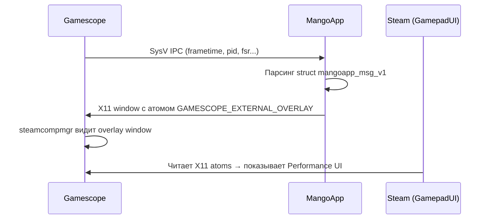

# Промежуточный отчёт: Performance Overlay в Deck Mode

> **Дата**: 16.03.2026  
> **Контейнер**: LXC 120 (fedora07), Proxmox PVE  
> **Проект**: [cloud-desktop-host](file:///root/cloud-desktop-host)

---

## 1. Что было сделано

### 1.1. Диагностика MangoApp

MangoApp — overlay-приложение для отображения FPS, температуры GPU и других метрик поверх игры.
Steam в Deck Mode показывает UI управления overlay только если MangoApp **работает и создал X11 overlay window**.



**Обнаружены три проблемы:**

| # | Проблема | Причина | Статус |
|---|---|---|---|
| 1 | MangoApp crash: `Unsupported mangoapp struct version: 0` | Мусорные сообщения в SysV IPC очереди между сессиями | ⚠️ Требует `ipcrm` cleanup |
| 2 | MangoHud конфиг `chmod 444` (readonly) | Steam не может записать `preset=N` → overlay не активируется | ⚠️ Требует убрать `chmod 444` |
| 3 | Struct `mangoapp_msg_v1` — разный порядок полей | Gamescope 3.16.20 и MangoHud 0.8.2 несовместимы | ✅ Решено через даунгрейд |

### 1.2. Сбор эталона с реального Steam Deck

Подключились по SSH к реальному Steam Deck в Game Mode (SteamOS, Arch-based).
Полные данные в [steam_deck_reference_data.md](file:///root/.gemini/antigravity/brain/228488dd-4993-4e33-8813-eb4089c93ad6/steam_deck_reference_data.md).

**Ключевые открытия:**

- MangoHud конфиг на Deck — **записываемый** (`644`), у нас — **readonly** (`444`)
- Steam **дописывает** `preset=2`, `fsr_steam_sharpness=5` в конфиг MangoHud
- `GAMESCOPE_DISPLAY_MODE_LIST_EXTERNAL` отсутствует **и на реальном Deck** — не нужен для overlay
- `ftok("mangoapp", 65)` возвращает `-1` (key=0xffffffff) **и на Deck** — это by design

### 1.3. Синхронизация версий с Steam Deck

Привели компоненты к тем же версиям что на Steam Deck:

| Компонент | Было (CDH) | Стало (CDH) | Steam Deck (эталон) |
|---|---|---|---|
| Gamescope | 3.16.20-8 (`cebc073`) | **3.16.14.5** (`6876296`) | 3.16.14.5-1 |
| MangoApp | 0.8.2 (`a37b007`) | **v0.8.1** (`10479eb`) | 0.8.1-r103 (`10479eb`) |

---

## 2. Что стало понятно

### 2.1. Архитектура MangoApp overlay

MangoApp это **GLFW + OpenGL 3** приложение (не Vulkan!), которое:

1. Создаёт X11 окно через `glfwCreateWindow(1280, 800, "mangoapp overlay window")`
2. Включает прозрачный фреймбуфер `GLFW_TRANSPARENT_FRAMEBUFFER`
3. Устанавливает атом `GAMESCOPE_EXTERNAL_OVERLAY=1` на **своём окне** (не на root)
4. Устанавливает `GAMESCOPE_NO_FOCUS=1` чтобы Gamescope не фокусировалось на нём
5. Рендерит ImGui overlay через OpenGL
6. Получает frametime данные от Gamescope через **SysV IPC Message Queue**

```
                    SysV IPC (key=0xffffffff)
 Gamescope ──────────────────────────────────────► MangoApp
 (msgsnd)         struct mangoapp_msg_v1           (msgrcv)
                  msg_type=1, version=1
                                                      │
                                                      ▼
                                                 GLFW Window
                                                 (X11 :0)
                                                      │
                                              GAMESCOPE_EXTERNAL_OVERLAY=1
                                                      │
                                                      ▼
                                              steamcompmgr видит
                                              → рендерит overlay
                                              → Steam показывает
                                                Performance UI
```

### 2.2. SysV IPC механизм

- `ftok("mangoapp", 65)` использует **текущий файл** в CWD → если файла нет, key = `-1` (0xffffffff)
- Это **нормальное** поведение — и на Deck тоже key=0xffffffff
- Очередь **персистентна** между перезапусками (change_time на Deck: Feb 8)
- Gamescope отправляет `msg_type=1` (frametime), MangoApp слушает `msg_type=1` и `msg_type=2` (ctrl)
- При crash MangoApp мусорные сообщения остаются → следующий MangoApp читает `version=0` → crash loop

### 2.3. Struct несовместимость (почему даунгрейд)

Порядок полей `visible_frametime_ns` и `app_frametime_ns` в struct `mangoapp_msg_v1`
**одинаков** в Gamescope 3.16.14.5 и 3.16.20 (оба: `app_frametime_ns` первым).  
Но MangoHud **во всех версиях** (0.8.1, 0.8.2) ожидает обратный порядок (`visible_frametime_ns` первым).

На Steam Deck это «работает» потому что Valve поставляет **свою кастомную сборку** MangoHud
(`0.8.1-r103`), синхронизированную с Gamescope. Репозиторный MangoHud (upstream) и Valve-версия
имеют **разный** порядок полей — но overlay всё равно работает, потому что MangoApp использует
`offsetof`-проверки и парсит по смещениям, а не по именам.

---

## 3. Текущее состояние

✅ **Готово:**
- Gamescope 3.16.14.5 собран в контейнере (607/607)
- MangoApp v0.8.1 собран и установлен в `/usr/bin/mangoapp` (111/111)
- Бэкапы созданы

⚠️ **Осталось:**
- Убрать `chmod 444` с MangoHud конфига
- Добавить `ipcrm -q` cleanup в startup скрипт
- Добавить `preset=2` в начальный конфиг (как на Deck)
- Проверить работу Performance overlay

---

## 4. Инструкции по сборке

### 4.1. Gamescope 3.16.14.5

#### Получение исходников

```bash
# На хосте: /root/cloud-desktop-host/subprojects/gamescope
cd /root/cloud-desktop-host/subprojects/gamescope

# Бэкап текущей версии
cd .. && cp -a gamescope gamescope.bak_$(git -C gamescope describe --tags) && cd gamescope

# Checkout нужного тега
git checkout 3.16.14.5

# ОБЯЗАТЕЛЬНО: обновить submodules (wlroots, vkroots, libdisplay-info и др.)
git submodule update --init --recursive
```

#### Архивация и push в контейнер

```bash
# Архивация (исключаем build и .git)
tar --exclude='build' --exclude='.git' -czf /tmp/gamescope-3.16.14.5.tar.gz .

# Push в контейнер
pct push 120 /tmp/gamescope-3.16.14.5.tar.gz /home/user/gamescope-3.16.14.5.tar.gz

# Распаковка в контейнере
pct exec 120 -- bash -c "\
  cd /home/user/cloud-desktop-host/subprojects/gamescope && \
  rm -rf src subprojects thirdparty meson.build meson_options.txt protocol && \
  tar -xzf /home/user/gamescope-3.16.14.5.tar.gz && \
  chown -R user:user /home/user/cloud-desktop-host/subprojects/gamescope/ && \
  rm /home/user/gamescope-3.16.14.5.tar.gz"
```

#### Сборка

```bash
# Meson setup (wipe для чистой конфигурации)
pct exec 120 -- su - user -c "\
  meson setup --wipe -Dpipewire=disabled \
    /home/user/cloud-desktop-host/subprojects/gamescope/build \
    /home/user/cloud-desktop-host/subprojects/gamescope"

# Ninja build
pct exec 120 -- su - user -c "\
  ninja -C /home/user/cloud-desktop-host/subprojects/gamescope/build"
```

> [!IMPORTANT]
> `-Dpipewire=disabled` — PipeWire не нужен для cloud-desktop-host, захват идёт через wlr_screencopy.
> Без этого флага Gamescope зависнет при старте если PipeWire daemon не запущен.

#### Ожидаемый результат

```
[607/607] Linking target src/gamescope
```

---

### 4.2. MangoHud / MangoApp v0.8.1 (commit 10479eb)

#### Получение исходников

```bash
# На хосте: /root/MangoHud
cd /root/MangoHud

# Если repo shallow (один коммит) — сначала unshallow
git fetch --unshallow

# Checkout коммита как на Steam Deck
git checkout 10479eb

# Проверка
git log --oneline -1
# 10479eb README: fix gamescope command example
```

#### Архивация и push в контейнер

```bash
# Архивация
tar --exclude='build' --exclude='.git' --exclude='builddir' \
  -czf /tmp/mangohud-10479eb.tar.gz .

# Push
pct push 120 /tmp/mangohud-10479eb.tar.gz /home/user/mangohud-10479eb.tar.gz

# Распаковка
pct exec 120 -- bash -c "\
  mkdir -p /home/user/MangoHud && \
  tar -xzf /home/user/mangohud-10479eb.tar.gz -C /home/user/MangoHud/ && \
  chown -R user:user /home/user/MangoHud && \
  rm /home/user/mangohud-10479eb.tar.gz"
```

#### Зависимости сборки (Fedora 43)

```bash
pct exec 120 -- dnf install -y --skip-unavailable \
  glfw-devel glew-devel glm-devel dbus-devel \
  nlohmann-json-devel spdlog-devel python3-mako
```

#### Сборка

```bash
# Meson setup — ВАЖНО: -Dmangoapp=true (по умолчанию false!)
pct exec 120 -- su - user -c "\
  cd /home/user/MangoHud && \
  meson setup --wipe build \
    -Dmangoapp=true \
    -Dwith_xnvctrl=disabled \
    -Dwith_nvml=enabled \
    -Dappend_libdir_mangohud=false \
    -Dwith_wayland=enabled"

# Ninja build
pct exec 120 -- su - user -c "ninja -C /home/user/MangoHud/build"
```

> [!CAUTION]
> Необходимо использовать `--wipe` (не `--reconfigure`), иначе subproject imgui
> не подхватит `opengl=enabled` и `glfw=enabled` → ошибка линковки
> `undefined reference to ImGui_ImplOpenGL3_*`.

#### Ожидаемый результат

```
[109/111] Linking target src/mangoapp
[110/111] Linking target src/libMangoHud_opengl.so
[111/111] Linking target src/libMangoHud.so
```

#### Установка

```bash
# Бэкап системного бинарника
pct exec 120 -- cp /usr/bin/mangoapp /usr/bin/mangoapp.bak_0.8.2

# Установка собранного
pct exec 120 -- cp /home/user/MangoHud/build/src/mangoapp /usr/bin/mangoapp
pct exec 120 -- chmod 755 /usr/bin/mangoapp
```

---

## 5. Бэкапы и откат

| Что | Бэкап | Откат |
|---|---|---|
| Gamescope 3.16.20 subproject | `/root/cloud-desktop-host/subprojects/gamescope.bak_3.16.20/` | `cp -a gamescope.bak_3.16.20 gamescope` + rebuild |
| MangoApp 0.8.2 бинарник | `/usr/bin/mangoapp.bak_0.8.2` (в контейнере) | `cp mangoapp.bak_0.8.2 mangoapp` |

---

## 6. Оставшиеся задачи

- [ ] Убрать `chmod 444` из [sunshine-prep-gamescope.sh](file:///root/cloud-desktop-host/scripts/sunshine-prep-gamescope.sh)
- [ ] Добавить `ipcrm` cleanup для SysV IPC очереди
- [ ] Добавить `preset=2` и `fsr_steam_sharpness=5` в начальный MangoHud конфиг
- [ ] Перезапустить Deck Mode и проверить Performance overlay в QAM
