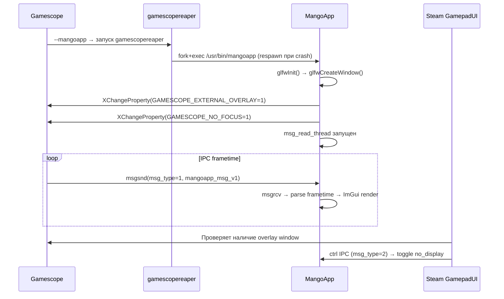
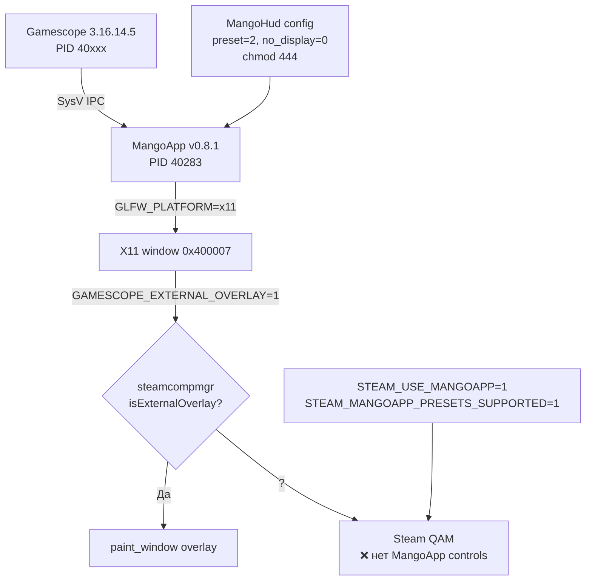

# Промежуточный отчёт: Performance Overlay в Deck Mode

> **Дата**: 16.03.2026 · **LXC 120** (fedora07) · Gamescope 3.16.14.5 · MangoHud v0.8.1 (10479eb)

---

## 1. Архитектура MangoApp overlay

MangoApp — отдельное приложение, которое отображает FPS/температуру/frametime поверх игры в Steam Deck Mode. Это **не** Vulkan layer, а standalone **GLFW + OpenGL 3** процесс.

```
┌──────────────┐   SysV IPC (msg_type=1)   ┌──────────────┐
│   Gamescope  │─────────────────────────→ │   MangoApp   │
│ (msgsnd)     │   struct mangoapp_msg_v1  │ (msgrcv)     │
│              │   key=0xffffffff           │              │
│  steamcompmgr│←──────────────────────────│ GLFW Window  │
│  видит окно  │   X11 window + atoms      │ (X11 :0)     │
└──────┬───────┘                            └──────────────┘
       │
       │ GAMESCOPE_EXTERNAL_OVERLAY=1 на окне MangoApp
       │ GAMESCOPE_NO_FOCUS=1 на окне MangoApp
       ▼
┌──────────────┐
│    Steam     │ Видит overlay → показывает
│  GamepadUI   │ Performance UI в QAM
└──────────────┘
```

### Жизненный цикл MangoApp



---

## 2. Обнаруженные проблемы

### 2.1 Struct `mangoapp_msg_v1` — несовместимость полей

**Gamescope** (все версии 3.16.x) и **MangoHud** (все версии 0.8.x) имеют **различный порядок полей** в struct `mangoapp_msg_v1`:

```diff
 // Gamescope src/mangoapp.cpp
 struct mangoapp_msg_v1 {
     mangoapp_msg_header hdr;
-    uint64_t app_frametime_ns;        // ← первым
-    uint64_t visible_frametime_ns;    // ← вторым
+    uint64_t visible_frametime_ns;    // MangoHud: первым
+    uint64_t app_frametime_ns;        // MangoHud: вторым
     // + доп. поля в Gamescope: displayRefresh, bAppWantsHDR...
 };
```

**Вывод**: На Deck это работает потому что Valve собирает **свою** версию MangoHud с синхронизированным struct. Upstream MangoHud использует `offsetof`-проверки, значения frametime будут **перепутаны**, но overlay отображается.

---

### 2.2 SysV IPC — персистентные очереди

- `ftok("mangoapp", 65)` → key `0xffffffff` (файл "mangoapp" не в CWD → `-1`)
- Это **нормально** и на Deck тоже `0xffffffff`
- Очередь **персистентна** между перезапусками → мусорные сообщения
- MangoApp читал `version=0` из старых сообщений → crash (`Unsupported mangoapp struct version: 0`)
- **Решение**: `ipcrm -q` cleanup перед запуском (пока не добавлено в скрипт)

---

### 2.3 MangoHud конфиг — `chmod 444` и preset

Steam в Deck Mode **перезаписывает** `MANGOHUD_CONFIGFILE`:
- Дописывает `no_display=1` (preset 0 = скрыть overlay)
- Дописывает `fsr_steam_sharpness`, `nis_steam_sharpness`

Это ломает MangoApp — overlay скрывается. На Deck конфиг записываемый (644) и Steam корректно управляет preset'ами. У нас **нет полного Valve-стека** → Steam пишет `no_display=1` некорректно.

**Решение**: `chmod 444` + все нужные параметры **прописаны заранее** в readonly конфиге:

```ini
control=mangohud
preset=2          # горизонтальный HUD (как на Deck)
no_display=0      # overlay показан
fsr_steam_sharpness=5
```

---

### 2.4 GLFW Wayland backend — критический баг на Fedora 43

**Корневая причина**: Fedora 43 поставляет `glfw-3.4` (универсальный, поддерживает X11 + Wayland). При наличии `WAYLAND_DISPLAY` в env (а у нас `GAMESCOPE_WAYLAND_DISPLAY=gamescope-0`) GLFW автоматически выбирает **Wayland backend**.

MangoApp создаёт **Wayland surface** вместо X11 window → `glfwGetX11Window()` возвращает `0` → `GAMESCOPE_EXTERNAL_OVERLAY` atom **не устанавливается** → Gamescope не видит overlay.

На Steam Deck установлен `glfw-x11` (только X11) — проблемы нет.

```
Fedora 43:  glfw-3.4-5.fc43  (universal: X11 + Wayland)
Steam Deck: glfw-3.4-1       (x11-only package)
```

**Решение**: `GLFW_PLATFORM=x11` в env block скрипта запуска.

**Диагностика через strace** (до фикса):
```
connect(..., @"/tmp/.X11-unix/X0") = -1 ECONNREFUSED
connect(..., "/tmp/.X11-unix/X0")  = -1 ENOENT
Glfw Error 65550: Failed to detect any supported platform
```

---

### 2.5 Valve-специфичные патчи MangoHud

Valve собирает MangoHud из **закрытого форка** (Packager: `GitLab CI Package Builder <ci-package-builder-1@steamos.cloud>`). Бинарник на Deck содержит строки, отсутствующие в upstream:

| Строка | Upstream 10479eb | Deck 0.8.1-r103 |
|---|---|---|
| `MANGOHUD_PRESETSFILE` | ❌ | ✅ |
| `presets.conf` | ❌ (код есть, файл нет) | ✅ |
| `parse_preset_config` | ✅ (код есть) | ✅ |
| `nis_steam_sharpness` | ❌ (`Unknown option`) | ✅ |
| `STEAM_MANGOAPP_PRESETS_SUPPORTED` | ✅ (env от Gamescope) | ✅ |

> [!NOTE]
> Код пресетов (`parse_preset`, `initialize_preset`, `toggle_preset`) **присутствует** в upstream MangoHud 0.8.1 — 14 совпадений в `overlay_params.cpp`. Но Valve добавляет **дополнительные** патчи для интеграции с Steam.

---

### 2.6 Анализ кода MangoApp — preset и no_display

Файл: [`MangoHud/src/overlay_params.cpp`](file:///root/MangoHud/src/overlay_params.cpp)

```cpp
// Строка 1214-1221 — presets() switch
void presets(int preset, struct overlay_params *params, bool inherit) {
    switch(preset) {
        case 0:  params->no_display = 1; break;  // ← СКРЫВАЕТ overlay
        case 1:  // FPS only
        case 2:  // horizontal HUD (как на Deck)
        case 3:  // detailed stats
        case 4:  // full debug
    }
}
```

```cpp
// Строка 903 — дефолтный preset list
std::vector<int> default_preset = {-1, 0, 1, 2, 3, 4};
// Строка 909 — первый preset = -1 (не попадает ни в один case)
current_preset = params->preset[0];  // = -1
```

Файл: [`MangoHud/src/app/main.cpp`](file:///root/MangoHud/src/app/main.cpp)

```cpp
// Строка 350-395 — main loop
if (!params.no_display) {
    if (mangoapp_paused) {
        glfwShowWindow(window);           // показать
        GAMESCOPE_EXTERNAL_OVERLAY = 1;   // atom = 1
        mangoapp_paused = false;
    }
    // render ImGui overlay...
} else if (!mangoapp_paused) {
    glfwHideWindow(window);               // СКРЫТЬ
    GAMESCOPE_EXTERNAL_OVERLAY = 0;       // atom = 0 !
    mangoapp_paused = true;
}
```

---

### 2.7 Debug MangoApp — подтверждение работы

Пересобрали MangoApp с `fprintf(stderr, "[MANGODBG] ...")` в ключевых точках.

Полный debug output текущей рабочей сессии:
```
[MANGODBG] glfwInit calling...
[MANGODBG] glfwInit OK
[MANGODBG] calling init()...
[MANGODBG] glfwCreateWindow(1280,800) calling...
[MANGODBG] glfwCreateWindow returned: 0xe225fc0        ← OK
[MANGODBG] x11_display=0xe1edf10 x11_window=0x400007   ← X11 WID
[MANGODBG] GAMESCOPE_EXTERNAL_OVERLAY=1 set on 0x400007 ← atom OK
[MANGODBG] init() returned window=0xe225fc0
[MANGODBG] Entering main loop. no_display=0 mangoapp_paused=0
[MANGODBG] loop iter=0 no_display=0 paused=0
[MANGODBG] loop iter=1 no_display=0 paused=0
[MANGODBG] loop iter=2 no_display=0 paused=0
```

**Всё работает**: GLFW init → X11 window → overlay atom → main loop с рендерингом.

---

## 3. Текущее состояние



### Что работает ✅

- Gamescope 3.16.14.5 собран и запускается
- MangoApp v0.8.1 собран, gamescopereaper перезапускает
- GLFW X11 window создаётся (0x400007)
- GAMESCOPE_EXTERNAL_OVERLAY atom установлен
- IPC frametime передаётся (timestamps обновляются)
- `no_display=0`, overlay рендерится через ImGui+OpenGL
- Env: `STEAM_USE_MANGOAPP=1`, `STEAM_MANGOAPP_PRESETS_SUPPORTED=1`

### Что не работает ❌

- Steam QAM → Производительность показывает **только базовый FPS** (встроенный Steam), **без MangoApp overlay controls** (ползунок уровня 0-4, GPU/CPU stats)

---

## 4. Гипотезы оставшейся проблемы

### Гипотеза 1: Timing

Steam GamepadUI проверяет наличие MangoApp overlay при **своём** старте. MangoApp запускается через gamescopereaper **после** Steam. Если Steam инициализирует Performance UI до появления MangoApp window → кэширует "нет MangoApp".

**Проверка**: запустить MangoApp **до** Steam, или перезапустить Steam после MangoApp.

### Гипотеза 2: PropertyNewValue bug

В `init()` (строка 236) используется `PropertyNewValue` вместо `PropModeReplace`:

```cpp
XChangeProperty(x11_display, x11_window, overlay_atom,
    XA_CARDINAL, 32, PropertyNewValue, ...);
//                   ^^^^^^^^^^^^^^^^ — это же PropModeReplace (=0)?
```

На строке 354 (main loop, после unpause) используется `PropModeReplace`. Возможно Gamescope steamcompmgr не получает PropertyNotify от первого `XChangeProperty` из-за `PropertyNewValue`.

### Гипотеза 3: Valve-специфичная проверка в Steam

Steam GamepadUI (закрытый код) может проверять дополнительные условия, которые не покрыты open-source MangoApp. Например, наличие `presets.conf` файла, или специфичный Valve-протокол.

---

## 5. Инструкции по сборке

### Gamescope 3.16.14.5

```bash
# На хосте
cd /root/cloud-desktop-host/subprojects/gamescope
git checkout 3.16.14.5 && git submodule update --init --recursive

# Архивация и push
tar --exclude='build' --exclude='.git' -czf /tmp/gamescope.tar.gz .
pct push 120 /tmp/gamescope.tar.gz /home/user/gamescope.tar.gz

# В контейнере
meson setup --wipe -Dpipewire=disabled build .
ninja -C build    # → 607/607
```

### MangoApp v0.8.1 (commit 10479eb)

```bash
# На хосте
cd /root/MangoHud && git checkout 10479eb

# В контейнере: зависимости Fedora 43
dnf install -y glfw-devel glew-devel glm-devel dbus-devel \
  nlohmann-json-devel spdlog-devel python3-mako

# Сборка — КРИТИЧНО: -Dmangoapp=true и --wipe
meson setup --wipe -Dmangoapp=true -Dwith_xnvctrl=disabled \
  -Dwith_nvml=enabled -Dappend_libdir_mangohud=false \
  -Dwith_wayland=enabled build
ninja -C build    # → 111/111

# Установка (обход gamescopereaper Text file busy)
cp build/src/mangoapp /usr/bin/mangoapp_new
pkill -9 -x mangoapp; mv /usr/bin/mangoapp_new /usr/bin/mangoapp
```

> [!CAUTION]
> Используйте `--wipe` (не `--reconfigure`), иначе imgui subproject не подхватит `opengl=enabled` и `glfw=enabled` → ошибка линковки `undefined reference to ImGui_ImplOpenGL3_*`.

---

## 6. Бэкапы

| Компонент | Путь бэкапа | Откат |
|---|---|---|
| Gamescope 3.16.20 | `subprojects/gamescope.bak_3.16.20/` (хост) | `cp -a` + rebuild |
| MangoApp 0.8.2 | `/usr/bin/mangoapp.bak_0.8.2` (контейнер) | `cp` |
| MangoApp наша 0.8.1 | `/usr/bin/mangoapp.bak_our_081` (контейнер) | `cp` |

---

## 7. Следующие шаги

- [ ] Разобраться почему Steam QAM не показывает MangoApp overlay controls
- [ ] Проверить гипотезу timing (MangoApp до Steam)
- [ ] Проверить `PropertyNewValue` vs `PropModeReplace`
- [ ] Сравнить steamcompmgr window detection на Deck vs CDH
- [ ] Убрать debug fprintf из MangoApp
- [ ] Добавить `ipcrm` cleanup в скрипт
