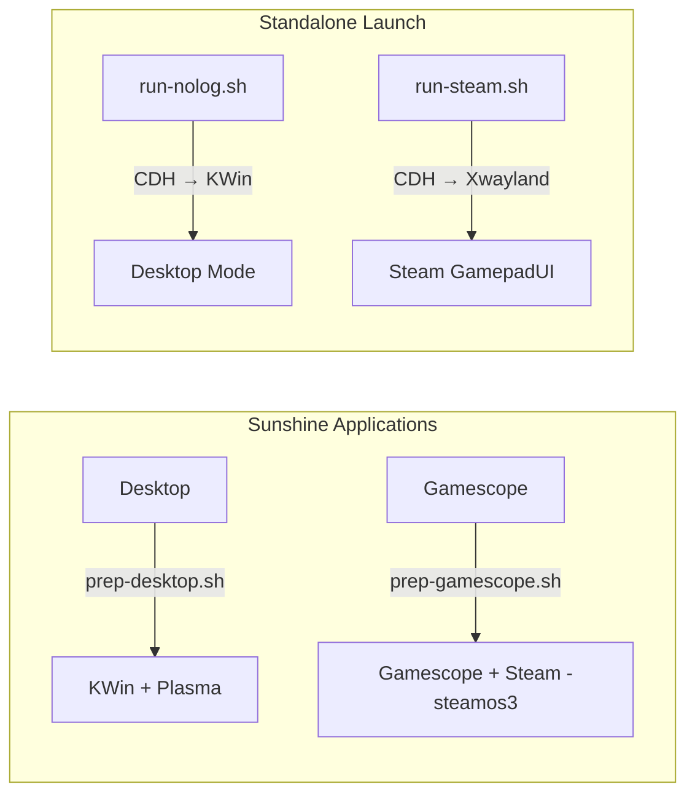
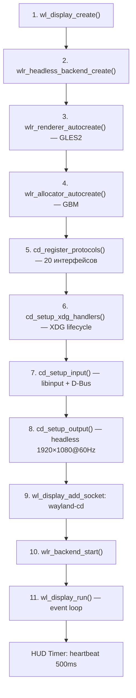
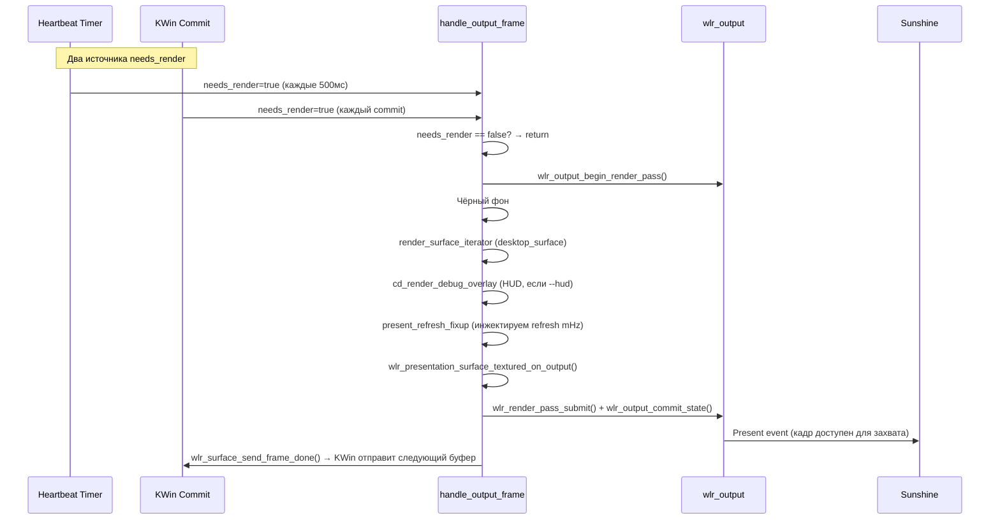
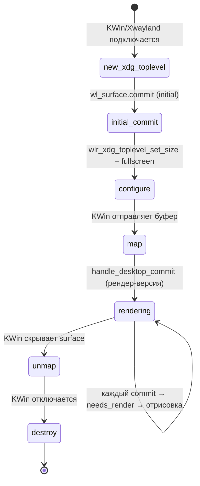
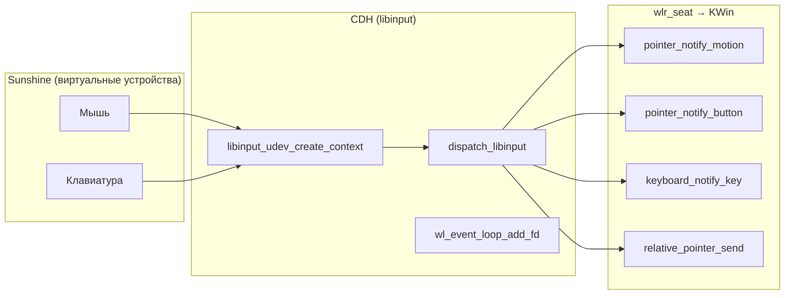
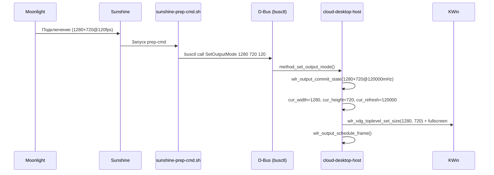

# Архитектура cloud-desktop-host (CDH)

> **Версия**: 0.1.0  
> **Язык**: C++17 (wlroots API через `extern "C"`)  
> **Система сборки**: Meson + Ninja  
> **Ключевая зависимость**: wlroots 0.18.3 (subproject)

---

## 1. Назначение проекта

**cloud-desktop-host** (CDH) — это **headless Wayland-композитор**, служащий ядром стека облачного рабочего стола. Он не имеет физического экрана и не использует DRM — вместо этого создаёт виртуальный output, к которому подключаются:

- **KWin** (как Wayland-клиент) — для полноценного рабочего стола Plasma
- **Xwayland** (напрямую) — для Steam GamepadUI
- **Gamescope** (как Wayland-клиент) — для SteamOS-режима
- **Sunshine** — для захвата и стриминга кадров через сеть

```
┌────────────────────────────────────────────────────────────────┐
│                         Moonlight (Клиент)                     │
│                    ┌───────────────────────────┐               │
│                    │      Sunshine Server       │               │
│                    │  (захват кадров + кодинг)  │               │
│                    └─────────┬─────────────────┘               │
│                              │ wl_surface / D-Bus              │
│              ┌───────────────┴───────────────┐                 │
│              │     cloud-desktop-host (CDH)    │                │
│              │     Headless wlroots compositor  │               │
│              │     Socket: wayland-cd           │               │
│              └───┬───────────────┬──────────┘                  │
│                  │               │                              │
│     ┌────────────┴───┐   ┌──────┴──────────┐                   │
│     │  KWin Wayland   │   │   Xwayland      │                  │
│     │  Socket:        │   │   DISPLAY=:0    │                  │
│     │  wayland-0      │   │                 │                  │
│     └──┬──────────┬───┘   └───────┬─────────┘                  │
│        │          │               │                             │
│   ┌────┴────┐ ┌───┴───┐   ┌──────┴──────┐                     │
│   │ Plasma  │ │ Игры  │   │ Steam       │                     │
│   │ shell   │ │       │   │ GamepadUI   │                     │
│   └─────────┘ └───────┘   └─────────────┘                     │
└────────────────────────────────────────────────────────────────┘
```

---

## 2. Режимы работы

CDH поддерживает **три режима** переключения контента, управляемые через Sunshine prep/undo скрипты:

| Режим | Цепочка | Скрипт prep | Скрипт undo | Флаг CDH |
|---|---|---|---|---|
| **Desktop (Plasma)** | CDH → KWin → Plasma/Игры | [sunshine-prep-desktop.sh](../scripts/sunshine-prep-desktop.sh) | [sunshine-undo-desktop.sh](../scripts/sunshine-undo-desktop.sh) | *(нет)* |
| **Steam Standalone** | CDH → Xwayland → Steam X11 | [sunshine-prep-cmd.sh](../scripts/sunshine-prep-cmd.sh) | — | `--no-auto-lock` |
| **Gamescope SteamOS** | CDH → Gamescope → Steam -steamos3 | [sunshine-prep-gamescope.sh](../scripts/sunshine-prep-gamescope.sh) | [sunshine-undo-gamescope.sh](../scripts/sunshine-undo-gamescope.sh) | *(нет)* |



---

## 3. Структура проекта

```
cloud-desktop-host/
├── meson.build                      # система сборки
├── src/
│   ├── main.cpp         (129 строк)  # точка входа + event loop
│   ├── server.h         (137 строк)  # центральная структура cd_server
│   ├── protocols.cpp    (189 строк)  # 20 Wayland-протоколов
│   ├── output.cpp       (223 строк)  # рендер-цикл + wp_presentation fixup
│   ├── xdg.cpp          (289 строк)  # XDG Shell lifecycle
│   ├── input.cpp        (271 строк)  # standalone libinput обработка
│   ├── dbus_input.cpp   (730 строк)  # D-Bus org.gamescope.Input
│   ├── dbus_input.h      (51 строк)  # D-Bus заголовок
│   ├── debug_ui.cpp     (179 строк)  # HUD overlay
│   └── debug_ui.h         (7 строк)  # HUD заголовок
├── scripts/
│   ├── run-nolog.sh                   # запуск Desktop-стека
│   ├── run-steam.sh                   # запуск Steam GamepadUI
│   ├── sunshine-prep-cmd.sh           # Sunshine: SetOutputMode + plasmashell --replace
│   ├── sunshine-prep-desktop.sh       # Sunshine: переключение в Desktop
│   ├── sunshine-prep-gamescope.sh     # Sunshine: запуск Gamescope + Steam
│   ├── sunshine-undo-desktop.sh       # Sunshine: очистка Desktop
│   └── sunshine-undo-gamescope.sh     # Sunshine: очистка Gamescope
├── tools/
│   └── gamescope-focus-daemon.c       # X11 daemon для Steam -steamos3
├── tests/
│   └── mouse-test.c                   # тест libinput
├── configs/
│   └── sunshine/                      # конфигурация Sunshine
└── subprojects/
    └── wlroots/                       # wlroots 0.18.3 (subproject)
```

---

## 4. Архитектура модулей

### 4.1 Центральная структура `cd_server` ([server.h](../src/server.h))

Единая глобальная структура, хранящая **всё состояние** композитора:

```
┌─────────────────────────── cd_server ───────────────────────────┐
│ Core        │ wl_display, backend (headless), renderer, allocator│
│ Output      │ wlr_output, output_layout, frame/timing state      │
│ XDG Shell   │ xdg_shell, desktop_toplevel, desktop_surface       │
│ Seat        │ wlr_seat, pointer_constraints, relative_pointer    │
│ Input       │ libinput_ctx, udev_ctx, keyboard/pointer state     │
│ D-Bus       │ cd_dbus_input (org.gamescope.Input)                │
│ HUD         │ fps, commit_rate, mouse_dx/dy, mode (FREE/LOCKED) │
└─────────────────────────────────────────────────────────────────┘
```

Ключевые поля и их назначение:

| Группа | Поле | Тип | Назначение |
|---|---|---|---|
| Core | `display` | `wl_display*` | Wayland event loop |
| Core | `backend` | `wlr_backend*` | Headless backend (без DRM) |
| Core | `renderer` | `wlr_renderer*` | GLES2 рендерер |
| Flags | [debug](../src/debug_ui.cpp#112-179) | `bool` | `--debug`: WLR_DEBUG логи |
| Flags | [hud](../src/main.cpp#20-33) | `bool` | `--hud`: HUD overlay |
| Flags | `no_auto_lock` | `bool` | `--no-auto-lock`: режим Steam |
| Output | [output](../src/output.cpp#191-223) | `wlr_output*` | Единственный headless output |
| Output | `cur_width/height/refresh` | [int](../src/input.cpp#99-117) | Динамический режим (через D-Bus) |
| Output | `needs_render` | `bool` | Damage flag для рендера |
| XDG | `desktop_toplevel` | `wlr_xdg_toplevel*` | KWin/Xwayland как toplevel |
| XDG | `desktop_surface` | `wlr_surface*` | Рендеримая поверхность |
| Seat | `has_active_constraint` | `bool` | LOCKED режим указателя |
| Seat | `pointer_lock_sent` | `bool` | Авто-RCTRL отправлен |
| Input | `libinput_ctx` | `libinput*` | Standalone libinput |
| D-Bus | [dbus_input](../src/dbus_input.h#18-33) | [cd_dbus_input](../src/dbus_input.h#18-33) | D-Bus сервис |

### 4.2 Инициализация ([main.cpp](../src/main.cpp))

Последовательность запуска (11 шагов):



> [!IMPORTANT]
> **Heartbeat Timer** — раз в 500мс принудительно устанавливает `needs_render = true` и вызывает `wlr_output_schedule_frame()`. Это предотвращает таймаут Sunshine (starvation) и зависание KWin (без `frame_done` KWin не отправит следующий буфер).

### 4.3 Wayland-протоколы ([protocols.cpp](../src/protocols.cpp))

CDH регистрирует **20 протоколов**, необходимых для работы KWin:

| # | Протокол | Версия | Назначение |
|---|---|---|---|
| 1 | `wl_compositor` | v6 | Создание surfaces |
| 2 | `wl_subcompositor` | — | Subsurfaces (KWin требует) |
| 3 | `wl_shm` | — | Shared memory буферы (авто) |
| 4 | `xdg_wm_base` | v6 | XDG Shell (toplevel lifecycle) |
| 5 | `wp_viewporter` | — | Viewport трансформации |
| 6 | `wp_single_pixel_buffer_v1` | — | Однопиксельные буферы |
| 7 | `zwp_linux_dmabuf_v1` | v5 | Zero-copy DMA-BUF |
| 8 | `wl_seat` | — | Ввод (pointer + keyboard) |
| 9 | `wl_output_layout` | — | Позиционирование output |
| 10 | `xdg_output_manager_v1` | — | XDG output информация |
| 11 | `wlr_screencopy_v1` | — | Захват экрана (Sunshine) |
| 12 | `wp_presentation` | — | Frame timing (FPS игр) |
| 13 | `xdg_decoration_manager_v1` | — | Серверное декорирование |
| 14 | `wp_fractional_scale_v1` | v1 | Дробное масштабирование |
| 15 | `zwp_pointer_constraints_v1` | — | Захват указателя (LOCKED) |
| 16 | `xdg_activation_v1` | — | Активация окон |
| 17 | `wl_data_device_manager` | — | Буфер обмена |
| 18 | `wp_content_type_v1` | v1 | Тип контента |
| 19 | `zwp_relative_pointer_v1` | — | Относительные движения мыши |
| 20 | **PID-фильтр** | — | `xdg_wm_base` только для KWin/Xwayland/Gamescope |

> [!CAUTION]
> **PID-фильтр** — критический компонент безопасности. `xdg_wm_base` виден **только** процессам `kwin_wayland`, `Xwayland` или [gamescope](../src/protocols.cpp#67-72). Это предотвращает создание toplevel окна нежелательными клиентами (например, GTK tray Sunshine). Без фильтра Sunshine создаёт XDG surface и зависает.

Логика фильтрации по режиму:
```
KWin-режим:     xdg_wm_base виден → kwin_wayland, gamescope
Steam-режим:    xdg_wm_base виден → Xwayland, gamescope
(--no-auto-lock)
```

### 4.4 Рендер-цикл ([output.cpp](../src/output.cpp))



#### Damage-driven подход

Рендер **не** происходит безусловно каждый кадр. Флаг `needs_render` устанавливается только при:
- Новом commit от KWin ([handle_desktop_commit](../src/xdg.cpp#50-69))
- Событии ввода (мышь, клавиатура)
- Heartbeat таймере (каждые 500мс)

Если `needs_render == false`, [handle_output_frame](../src/output.cpp#74-190) просто возвращается, не тратя GPU.

#### Present Refresh Fixup

> [!WARNING]
> Headless backend wlroots отправляет [present](../src/output.cpp#48-73) event с `refresh=0`. KWin читает это 0 и остаётся на стартовом 60000 mHz. Без фикса KWin не «видит» изменение частоты через `SetOutputMode`.

**Решение**: [handle_present_refresh_fixup](../src/output.cpp#48-73) вставляется в **HEAD** списка `wl_listener`, чтобы сработать **ДО** `wlr_presentation` feedback listener. Он инжектирует корректный [refresh](../tools/gamescope-focus-daemon.c#120-125) из `server->cur_refresh` (пересчёт mHz → наносекунды).

#### Animation Fallback

Если `desktop_surface == NULL` (ни KWin, ни Xwayland не подключены), CDH рисует **цветную синусоидальную анимацию** — визуальное подтверждение работы стриминга.

### 4.5 XDG Shell Lifecycle ([xdg.cpp](../src/xdg.cpp))



Ключевые моменты lifecycle:

1. **[handle_new_xdg_toplevel](../src/xdg.cpp#239-277)** — регистрирует первый toplevel как `desktop_toplevel`. Все последующие toplevel игнорируются (получают size 0×0).

2. **[handle_xdg_surface_commit](../src/xdg.cpp#179-238)** (handshake-версия) — обрабатывает `initial_commit`:
   - Устанавливает размер из текущего `cur_width×cur_height` (не из дефолтов — режим мог быть изменён через `SetOutputMode` до подключения KWin)
   - Отправляет `configure` с fullscreen
   - **Fallback**: если клиент не вызывает [map](../src/xdg.cpp#70-141) (Gamescope/libdecor), детектирует наличие буфера и делает ручной map

3. **[handle_desktop_map](../src/xdg.cpp#70-141)** — переключает commit listener с handshake на рендер-версию, устанавливает фокус (pointer + keyboard), запускает **таймер авто-pointer-lock** (200мс)

4. **[handle_desktop_commit](../src/xdg.cpp#50-69)** (рендер-версия) — увеличивает счётчик коммитов, устанавливает `needs_render`, планирует перерисовку

#### Автоматический Pointer Lock

```
desktop_map → ожидание 200мс → RCTRL press+release → KWin вызывает
togglePointerLock() → zwp_locked_pointer_v1 → CDH активирует →
KWin рисует курсор в framebuffer → курсор виден в стриме
```

> [!NOTE]
> Автоматический лок **пропускается** для: `--no-auto-lock` (Steam-режим), клиента с `comm == "gamescope"` (Gamescope скрывает курсор при `m_bPointerLocked=true`).

### 4.6 Обработка ввода ([input.cpp](../src/input.cpp))

CDH использует **standalone libinput** (не через wlr_backend), подключаясь напрямую к udev/seat0 в LXC контейнере.



Обрабатываемые типы событий:

| Событие libinput | Обработчик | wlr_seat API |
|---|---|---|
| `POINTER_MOTION` | [handle_pointer_motion](../src/input.cpp#28-73) | `pointer_notify_motion` + `relative_pointer_send` |
| `POINTER_MOTION_ABSOLUTE` | [handle_pointer_motion_abs](../src/input.cpp#74-98) | `pointer_notify_motion` |
| `POINTER_BUTTON` | [handle_pointer_button](../src/input.cpp#99-117) | `pointer_notify_button` |
| `POINTER_SCROLL_WHEEL` | [handle_scroll_wheel](../src/input.cpp#126-146) | `pointer_notify_axis` (v120) |
| `POINTER_SCROLL_FINGER` | [handle_scroll_continuous](../src/input.cpp#147-167) | `pointer_notify_axis` (finger) |
| `POINTER_SCROLL_CONTINUOUS` | [handle_scroll_continuous](../src/input.cpp#147-167) | `pointer_notify_axis` (continuous) |
| `KEYBOARD_KEY` | [handle_keyboard_key](../src/input.cpp#168-185) | `keyboard_notify_key` |
| `DEVICE_ADDED/REMOVED` | D-Bus registration | `cd_dbus_input_device_added/removed` |

#### Два режима указателя

| Режим | `has_active_constraint` | Поведение |
|---|---|---|
| **FREE** | `false` | Absolute position → `pointer_notify_motion` |
| **LOCKED** | `true` | **Только** relative motion → `relative_pointer_send` |

В **FREE** режиме CDH поддерживает абсолютную позицию курсора (`cursor_x`, `cursor_y`) с клиппингом по границам output. В **LOCKED** режиме абсолютная позиция не отправляется, KWin использует относительные ускорения для управления FPS-курсором.

#### Scroll Factor

Коэффициент скролла ([scroll_factor](../src/input.cpp#118-125)) хранится **per-device** в D-Bus сервисе и не имеет аналога в libinput API. Значение по умолчанию — `8.0`. Получается по `sysname` устройства перед применением к `wlr_seat_pointer_notify_axis`.

### 4.7 D-Bus сервис ([dbus_input.cpp](../src/dbus_input.cpp) + [dbus_input.h](../src/dbus_input.h))

Самый объёмный модуль (730 строк). Предоставляет два D-Bus интерфейса:

#### `org.gamescope.InputDeviceManager` (на `/org/gamescope/Input`)

| Элемент | Тип | Сигнатура |
|---|---|---|
| `devicesSysNames` | Property (ro) | `as` |
| `deviceAdded` | Signal | `s` |
| `deviceRemoved` | Signal | `s` |
| **`SetOutputMode`** | **Method** | `uuu → b` |

#### `org.gamescope.InputDevice` (на `/org/gamescope/Input/Device/{sysname}`)

~30 свойств для каждого устройства ввода, включая:
- **RO**: [name](../src/dbus_input.cpp#30-36), `sysName`, [pointer](../src/input.cpp#99-117), [keyboard](../src/input.cpp#168-185), `touchpad`, `touch`, `supportedButtons`, `supports*`
- **RW**: `pointerAcceleration`, `pointerAccelerationProfileFlat/Adaptive`, `naturalScroll`, `scrollFactor`, `leftHanded`, `middleEmulation`, `enabled`, `scrollOnButtonDown`

> [!TIP]
> Этот D-Bus интерфейс совместим с **KCM Cloud Mouse** — специализированным KDE модулем настроек мыши для облачного рабочего стола. KCM подключается к `org.gamescope.Input` и конфигурирует libinput устройства через D-Bus свойства.

#### `SetOutputMode(width, height, fps)`

Центральный метод динамического изменения режима:



Валидация: `width ∈ [1, 7680]`, `height ∈ [1, 4320]`, `fps ∈ [1, 360]`.

#### Персистентность настроек

Настройки устройств сохраняются в `~/.config/gamescope-input.conf` (INI-формат, секции по `sysname`). Загружаются автоматически при подключении устройства ([cd_dbus_input_device_added](../src/dbus_input.h#39-41)).

### 4.8 HUD Overlay ([debug_ui.cpp](../src/debug_ui.cpp))

Диагностический overlay, включаемый флагом `--hud`:

```
┌──────────────────────────────────────┐
│ FPS: 120.0 / 120HZ                  │  ← зелёный
│ KWIN: 119.8 C/S                     │  ← светло-зелёный
│ DXY: 2.3  -1.5                      │  ← голубой
│ COUNT NEW POINTER CONSTRAINT: 1     │  ← оранжевый/серый
│ SYSTEM MODE: LOCKED                 │  ← красный/зелёный
│ WATCHDOG WL SURFACE FRAME: 4523     │  ← белый
└──────────────────────────────────────┘
```

- Использует **встроенный растровый шрифт** 8×16 (IBM CP437 subset)
- Рендеринг через `pixman` → `wlr_texture_from_pixels` → `wlr_render_pass_add_texture`
- Позиция: [(20, 20)](../src/main.cpp#34-129), размер: `320×130`

### 4.9 Утилита `gamescope-focus-daemon` ([tools/gamescope-focus-daemon.c](../tools/gamescope-focus-daemon.c))

X11 daemon, эмулирующий подмножество `steamcompmgr` для работы Steam `-steamos3` внутри KWin:

- Устанавливает `GAMESCOPE_PID` на root window (Steam проверяет наличие)
- Отслеживает `STEAM_GAME` property на окнах (рекурсивный поиск до глубины 5)
- Реагирует на `GAMESCOPECTRL_BASELAYER_APPID` от Steam для переключения фокуса
- Обновляет `GAMESCOPE_FOCUSED_APP`, `GAMESCOPE_FOCUSED_APP_GFX`, `GAMESCOPE_FOCUSED_WINDOW`, `GAMESCOPE_INPUT_COUNTER`, `GAMESCOPE_FOCUSABLE_APPS/WINDOWS`
- Начальный фокус: Steam (appid=769)

---

## 5. Зависимости и сборка

### Зависимости (meson.build)

| Зависимость | Источник | Назначение |
|---|---|---|
| `wlroots` 0.18.3 | subproject | Wayland compositor library |
| `wayland-server` | system | Wayland протокол |
| `wayland-protocols` ≥1.35 | system | XML описания протоколов |
| `glesv2` | system | OpenGL ES 2.0 рендеринг |
| [libinput](../src/input.cpp#238-244) | system | Обработка ввода |
| `libudev` | system | Обнаружение устройств |
| `libsystemd` (sd-bus) | system | D-Bus IPC |
| `libm` | system | Математические функции |

### Сборка

```bash
# На хосте — правка исходников:
vim /root/cloud-desktop-host/src/output.cpp

# Деплой файла в контейнер:
pct push 120 /root/cloud-desktop-host/src/output.cpp \
             /home/user/cloud-desktop-host/src/output.cpp

# Сборка внутри контейнера:
pct exec 120 -- bash -c "cd /home/user/cloud-desktop-host && ninja -C build"
```

---

## 6. Скрипты запуска

### [run-nolog.sh](../scripts/run-nolog.sh) — Desktop режим

Порядок запуска стека:

```
1. Убить предыдущую сессию (kill_all_stack)
2. D-Bus session launch
3. PipeWire → WirePlumber → PipeWire-Pulse
4. kactivitymanagerd (QT_QPA_PLATFORM=offscreen)
5. CDH (WLR_BACKENDS=headless, socket: wayland-cd)
6. Sunshine (WAYLAND_DISPLAY=wayland-cd)
```

> KWin, Plasma, Polkit **не запускаются** скриптом — они стартуют через Sunshine prep-cmd при подключении клиента.

### [run-steam.sh](../scripts/run-steam.sh) — Steam GamepadUI режим

```
1-4. Аналогично run-nolog.sh
5. CDH с --no-auto-lock
6. Xwayland fullscreen (WAYLAND_DISPLAY=wayland-cd, DISPLAY=:0)
7. Steam -gamepadui -noverifyfiles (DISPLAY=:0, XDG_CURRENT_DESKTOP=steamos)
8. Sunshine
```

### Sunshine prep/undo скрипты

| Скрипт | Действие |
|---|---|
| [sunshine-prep-cmd.sh](../scripts/sunshine-prep-cmd.sh) | `SetOutputMode` → `plasmashell --replace` |
| [sunshine-prep-desktop.sh](../scripts/sunshine-prep-desktop.sh) | Cleanup Gamescope → `SetOutputMode` → KWin (если нет) → Plasma stack |
| [sunshine-prep-gamescope.sh](../scripts/sunshine-prep-gamescope.sh) | Cleanup всего → Gamescope nested → Steam -steamos3 |
| [sunshine-undo-desktop.sh](../scripts/sunshine-undo-desktop.sh) | Kill Plasma (plasmashell, kded6, polkit) |
| [sunshine-undo-gamescope.sh](../scripts/sunshine-undo-gamescope.sh) | Kill Steam + Gamescope + Xwayland |

---

## 7. Потоки данных

### Кадр от KWin до Moonlight

```
KWin рендерит Plasma → wl_surface.commit(dmabuf) →
CDH: handle_desktop_commit → needs_render=true → wlr_output_schedule_frame →
handle_output_frame → render desktop_surface → wlr_output_commit_state →
present event → wlr_screencopy → Sunshine capture →
NVENC H.265 encode → Moonlight decode → дисплей
```

### Ввод от Moonlight до KWin

```
Moonlight HID events → Sunshine → /dev/uinput →
CDH: libinput_dispatch → handle_pointer_motion →
wlr_seat_pointer_notify_motion (FREE) / relative_pointer_send (LOCKED) →
KWin Wayland protocol → приложение
```

### Смена разрешения

```
Moonlight подключается (1280×720@120) → Sunshine env vars →
sunshine-prep-cmd.sh → busctl SetOutputMode 1280 720 120 →
CDH: wlr_output commit + xdg_toplevel resize → KWin configure →
Plasma reinit → Sunshine stream starts
```

---

## 8. Ключевые архитектурные решения

| Решение | Причина | Альтернатива |
|---|---|---|
| **Headless backend** | Нет физического экрана, LXC без DRM Master | DRM backend (невозможен в LXC) |
| **Standalone libinput** | wlr_backend headless не создаёт input devices | wlr_libinput_backend (нет в headless) |
| **PID-фильтр xdg_wm_base** | Sunshine GTK tray создаёт XDG surface и зависает | Нет фильтра → deadlock |
| **Present refresh fixup** | Headless backend шлёт `refresh=0` → KWin не видит смену FPS | Патчить wlroots (нежелательно) |
| **Heartbeat 500ms** | Без frame_done KWin замерзает, Sunshine падает по таймауту | Event-driven only → starvation |
| **D-Bus org.gamescope.\*** | Совместимость с KCM Cloud Mouse (KDE settings) | Собственный протокол |
| **Auto pointer lock** | Курсор KWin не виден в стриме без pointer lock | Ручной RCTRL при каждом подключении |
| **Damage-driven рендер** | Экономия GPU при отсутствии изменений | Постоянный рендер → нагрузка |

---

## 9. Ограничения и особенности

> [!CAUTION]
> - **Только один desktop toplevel одновременно.** Второй toplevel получает `size(0,0)` и игнорируется.
> - **Порядок запуска критичен.** D-Bus должен быть доступен до CDH. PipeWire — до Sunshine. CDH — до KWin.
> - **Статические переменные в FPS-подсчёте** (`output.cpp:173-175`) — не thread-safe, но допустимо т.к. [handle_output_frame](../src/output.cpp#74-190) вызывается только из main event loop.
> - **wlroots** подключается как **git submodule** (см. [SUBPROJECTS.md](SUBPROJECTS.md)) — в индексе основного репозитория хранится только SHA коммита. Собственный код CDH — порядка двух тысяч строк.

---

## 10. Стриминг в Moonlight: кадры, адаптивная частота и CUDA/NVENC

Цепочка от рабочего стола до клиента разделена на **композитор (CDH)**, **захват и кодирование (Sunshine)** и **декодирование (Moonlight)**.

### 10.1 Где заканчивается CDH и начинается Sunshine

1. **KWin / Xwayland / Gamescope** коммитят контент в `wl_surface` (часто **DMA-BUF**, без лишнего копирования на CPU со стороны клиента).
2. **CDH** (wlroots + GLES2 + GBM allocator) **композитит** эти буферы в один headless output и делает `wlr_output_commit_state`.
3. **Sunshine** подключается к тому же сокету Wayland (`wayland-cd`), использует протокол **wlr_screencopy** (и связанный пайплайн захвата wlroots) и отдаёт кадры в **аппаратный энкодер** (типично **NVENC на NVIDIA**, внутри драйвера и стека это опирается на **CUDA**-совместимую подсистему и низкоуровневые API Video Codec SDK).

CDH **не** выполняет H.264/H.265 сам по себе: его задача — стабильный Wayland-композитор с корректным **таймингом кадров** и **refresh** для клиентов.

### 10.2 «Адаптивная» частота и согласование с Moonlight

При подключении Moonlight Sunshine передаёт в окружение prep-команд размеры и FPS клиента (`SUNSHINE_CLIENT_WIDTH`, `SUNSHINE_CLIENT_HEIGHT`, `SUNSHINE_CLIENT_FPS`). Скрипт вызывает D-Bus **`SetOutputMode(width, height, fps)`** → CDH коммитит новый режим output и обновляет `cur_refresh` в **мГц (mHz)**.

**Нюанс headless backend:** событие present от wlroots может уходить с **`refresh = 0`**. Тогда KWin (и Gamescope) не получают осмысленный период кадра и остаются на дефолтной частоте. В CDH это компенсируется **present refresh fixup** ([`output.cpp`](../src/output.cpp)): в цепочку listeners вставляется обработчик, который подставляет период кадра из `server->cur_refresh`, так что **wp_presentation** отражает реальную договорённость с Moonlight (вплоть до **144 Hz** и выше в пределах валидации `SetOutputMode`).

### 10.3 Почему при этом низкая нагрузка на GPU (в т.ч. при 144 Hz)

- **Damage-driven рендер:** пока нет нового commit от desktop surface, ввода и принудительного heartbeat, [`handle_output_frame`](../src/output.cpp) **не** делает лишний `commit_state` (см. комментарий в коде про «0 FPS» при полном отключении — баланс между экономией и starvation).
- **Heartbeat 500 ms** ([`main.cpp`](../src/main.cpp)): редкий принудительный кадр, чтобы не было «голодания» `frame_done` при простоях (важно для Sunshine и для KWin/Gamescope).
- **Курсор в стриме:** при необходимости используется цепочка **pointer lock** (авто-RCTRL при маппинге), чтобы KWin рисовал курсор в том же буфере, который уходит в захват.

Итоговая нагрузка на хост зависит от сцены (Plasma, игра, разрешение), но архитектурно заложено **не крутить полный композитинг без изменений контента**.

### 10.4 Декод на клиенте (CUVID / NVDEC)

На стороне **Moonlight** типичен аппаратный декод (**NVDEC** и т.п.; в документации и обсуждениях часто встречается связка с **CUVID**/Video Codec API). Это отдельный этап от CDH; важно не смешивать: **энкод** — Sunshine/GPU хоста, **декод** — GPU/ПО клиента.

---

## 11. Приложения Sunshine: два профиля режимов

В [`configs/sunshine/apps.json`](../configs/sunshine/apps.json) заданы **две записи** в массиве `apps` — это два **логических профиля** запуска, которые пользователь выбирает в Moonlight перед сессией:

| Имя в Moonlight | Назначение | Prep / Undo |
|-----------------|------------|-------------|
| **Desktop** | Полноценный рабочий стол Plasma через KWin | [`sunshine-prep-desktop.sh`](../scripts/sunshine-prep-desktop.sh) / [`sunshine-undo-desktop.sh`](../scripts/sunshine-undo-desktop.sh) |
| **Steam Deck Mode** | Ветка «как на Deck»: nested Gamescope + Steam `-steamos3` | [`sunshine-prep-gamescope.sh`](../scripts/sunshine-prep-gamescope.sh) / [`sunshine-undo-gamescope.sh`](../scripts/sunshine-undo-gamescope.sh) |

Отдельно от этого в стеке используется **глобальный** prep Sunshine (например [`sunshine-prep-cmd.sh`](../scripts/sunshine-prep-cmd.sh)): **SetOutputMode** под выбранное в Moonlight разрешение и FPS + действия вроде `plasmashell --replace` для согласования Plasma с новым режимом.

---

## 12. Wayland «на GPU» и кастомизация мыши

- **Композитинг:** CDH использует **wlroots renderer (GLES2)** и **GBM allocator** — типичный путь **GPU-композиции** и работы с dmabuf от клиентов; физический DRM-вывод не обязателен (headless backend).
- **Мышь и устройства:** ввод идёт через **standalone libinput** и публикуется в **wlr_seat**; дополнительно реализован D-Bus **org.gamescope.Input** (совместимость с **KCM Cloud Mouse**): per-device свойства вроде **`scrollFactor`**, профили ускорения, natural scroll и т.д., с сохранением в `~/.config/gamescope-input.conf`.
