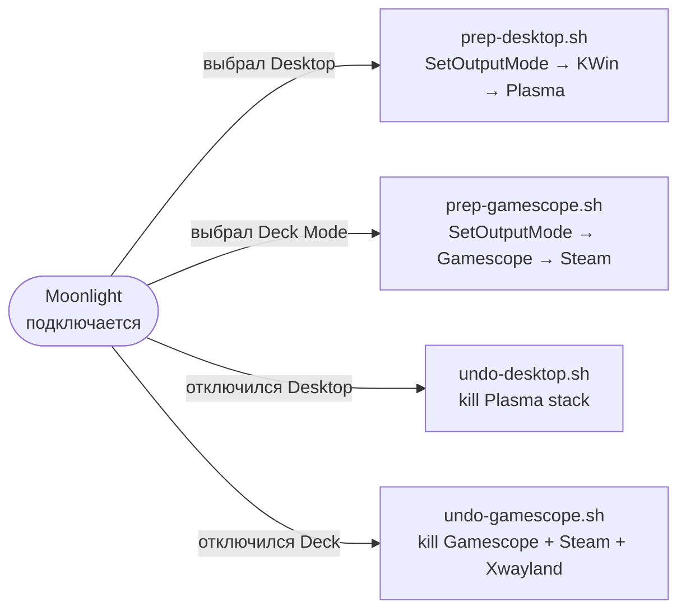
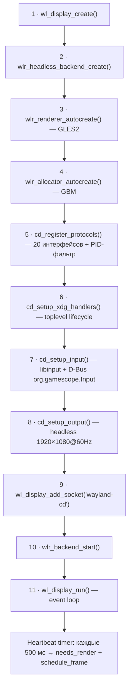
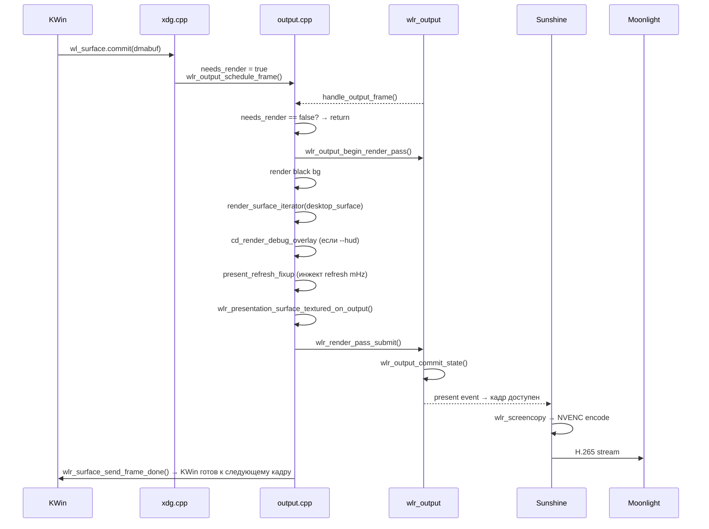
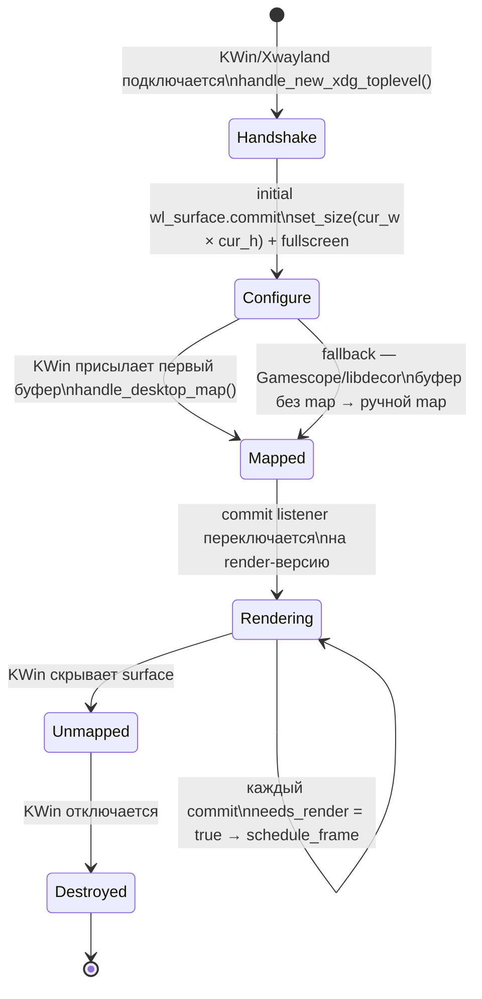
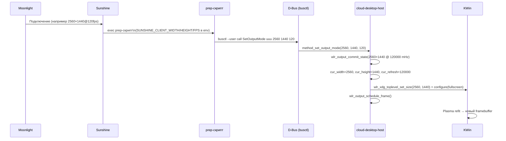

# Архитектура cloud-desktop-host (CDH)

> **Версия:** 0.1.0 · **Язык:** C++17 · **Сборка:** Meson + Ninja · **Ядро:** wlroots 0.20.2

---

## 1. Общая схема стека

```
╔══════════════════════════════════════════════════════════════════════╗
║  Proxmox VE — Хост                                                   ║
║  NVIDIA RTX 3090 · драйвер 580.126.09                                ║
║                                                                      ║
║  ┌────────────────────────────────────────────────────────────────┐  ║
║  │  LXC контейнер 120 (Fedora)                                    │  ║
║  │                                                                │  ║
║  │  ┌──────────────────────────────────────────────────────────┐  │  ║
║  │  │  cloud-desktop-host (CDH)                                │  │  ║
║  │  │  Headless Wayland compositor · socket: wayland-cd        │  │  ║
║  │  │  wlroots · GLES2/GBM · D-Bus org.gamescope.Input         │  │  ║
║  │  └────────┬──────────────────────────────┬───────────────────┘  │  ║
║  │           │ WAYLAND_DISPLAY=wayland-cd   │ WAYLAND_DISPLAY=wayland-cd ║
║  │  ┌────────┴────────┐           ┌─────────┴──────────┐          │  ║
║  │  │   KWin Wayland  │           │   Gamescope nested  │          │  ║
║  │  │   socket: wayland-0         │   (Steam Deck Mode) │          │  ║
║  │  └────────┬────────┘           └─────────┬──────────┘          │  ║
║  │           │                              │                      │  ║
║  │  ┌────────┴───────┐             ┌────────┴──────────┐          │  ║
║  │  │ Plasma + Игры  │             │ Steam -steamos3   │          │  ║
║  │  │ (Desktop Mode) │             │ MangoHud · FSR    │          │  ║
║  │  └────────────────┘             └───────────────────┘          │  ║
║  │                                                                │  ║
║  │  ┌──────────────────────────────────────────────────────────┐  │  ║
║  │  │  Sunshine           WAYLAND_DISPLAY=wayland-cd           │  │  ║
║  │  │  wlr_screencopy → NVENC H.265 → RTP/RTSP                 │  │  ║
║  │  └──────────────────────────────────────────────────────────┘  │  ║
║  └────────────────────────────────────────────────────────────────┘  ║
╚══════════════════════════════════════════════════════════════════════╝
                             │  H.265, ≤144 Hz, LAN
                    ┌────────┴────────┐
                    │  Moonlight      │  ПК / планшет / TV
                    │  NVDEC decode   │
                    └─────────────────┘
```

---

## 2. Режимы работы

CDH поддерживает три режима, между которыми можно переключаться без перезапуска композитора — через Sunshine prep/undo скрипты.

| Режим | Цепочка | Prep-скрипт | Undo-скрипт | Флаг CDH |
|-------|---------|-------------|-------------|----------|
| **Desktop (Plasma)** | CDH → KWin → Plasma/Игры | [sunshine-prep-desktop.sh](../scripts/sunshine-prep-desktop.sh) | [sunshine-undo-desktop.sh](../scripts/sunshine-undo-desktop.sh) | — |
| **Steam GamepadUI** | CDH → Xwayland → Steam X11 | [sunshine-prep-cmd.sh](../scripts/sunshine-prep-cmd.sh) | — | `--no-auto-lock` |
| **Steam Deck Mode** | CDH → Gamescope nested → Steam -steamos3 | [sunshine-prep-gamescope.sh](../scripts/sunshine-prep-gamescope.sh) | [sunshine-undo-gamescope.sh](../scripts/sunshine-undo-gamescope.sh) | — |



---

## 3. Структура проекта

```
cloud-desktop-host/
├── meson.build                    # система сборки, wlroots как subproject
├── src/                           # ~2000 строк — весь код CDH
│   ├── main.cpp        (129 стр)  # точка входа, 11-шаговая инициализация, heartbeat
│   ├── server.h        (137 стр)  # структура cd_server — единственное состояние
│   ├── protocols.cpp   (189 стр)  # регистрация 20 Wayland-протоколов + PID-фильтр
│   ├── output.cpp      (223 стр)  # рендер-цикл, damage-driven, present refresh fixup
│   ├── xdg.cpp         (289 стр)  # XDG Shell lifecycle, auto pointer lock
│   ├── input.cpp       (271 стр)  # standalone libinput, FREE/LOCKED режимы мыши
│   ├── dbus_input.cpp  (730 стр)  # D-Bus org.gamescope.Input: устройства + SetOutputMode
│   ├── dbus_input.h     (51 стр)  # заголовок D-Bus модуля
│   ├── debug_ui.cpp    (179 стр)  # HUD overlay: FPS, commits, mouse delta
│   └── debug_ui.h        (7 стр)  # заголовок HUD
├── scripts/
│   ├── run.sh                     # полный запуск стека с логами в /tmp/cdhost-logs/
│   ├── run-nolog.sh               # быстрый запуск без логов
│   ├── run-steam.sh               # Steam GamepadUI (Xwayland standalone)
│   ├── sunshine-prep-cmd.sh       # SetOutputMode + plasmashell --replace
│   ├── sunshine-prep-desktop.sh   # переключение в Desktop Mode
│   ├── sunshine-prep-gamescope.sh # запуск Gamescope + Steam -steamos3
│   ├── sunshine-undo-desktop.sh   # kill Plasma stack
│   └── sunshine-undo-gamescope.sh # kill Gamescope + Steam + Xwayland
├── tools/
│   └── gamescope-focus-daemon.c   # X11 daemon, эмуляция steamcompmgr
├── tests/
│   └── mouse-test.c               # тест libinput
├── configs/
│   └── sunshine/apps.json         # два профиля Sunshine: Desktop + Steam Deck Mode
└── subprojects/
    ├── wlroots/   @ 0.20.2        # git submodule — freedesktop.org
    ├── gamescope/ @ 3.16.14.5     # git submodule — ValveSoftware
    └── sunshine/  @ v2026.*       # git submodule — LizardByte
```

---

## 4. Центральная структура `cd_server`

Всё состояние компоzитора хранится в единой глобальной структуре [`cd_server`](../src/server.h). Нет синглтонов, нет глобальных переменных — только эта структура передаётся во все обработчики через `wl_container_of`.

```
┌────────────────────────────── cd_server ────────────────────────────────┐
│                                                                          │
│  Core          wl_display*        — Wayland event loop                  │
│                wlr_backend*       — headless backend (без DRM)          │
│                wlr_renderer*      — GLES2 рендерер                      │
│                wlr_allocator*     — GBM allocator (dmabuf)              │
│                                                                          │
│  Output        wlr_output*        — единственный виртуальный output     │
│                cur_width/height   — текущий режим (меняется SetOutputMode)│
│                cur_refresh        — текущий FPS в mHz                   │
│                needs_render       — damage флаг (damage-driven рендер)  │
│                                                                          │
│  XDG Shell     xdg_shell*         — обработчик toplevel lifecycle       │
│                desktop_toplevel*  — единственный активный toplevel      │
│                desktop_surface*   — рендеримая wl_surface               │
│                                                                          │
│  Seat / Input  wlr_seat*          — Wayland seat (pointer + keyboard)   │
│                libinput_ctx*      — standalone libinput context          │
│                udev_ctx*          — udev для обнаружения устройств       │
│                cursor_x/y         — абсолютная позиция курсора           │
│                has_active_constraint — LOCKED режим (pointer lock)      │
│                                                                          │
│  D-Bus         cd_dbus_input      — org.gamescope.Input сервис          │
│                                                                          │
│  HUD           hud_fps            — измеренный FPS                      │
│                hud_kwin_commit_rate — коммиты от KWin в сек             │
│                hud_mouse_dx/dy    — дельта мыши за кадр                 │
│                                                                          │
│  Flags         debug              — --debug: WLR_DEBUG logging          │
│                hud                — --hud: overlay поверх стрима        │
│                no_auto_lock       — --no-auto-lock: Steam-режим         │
└──────────────────────────────────────────────────────────────────────────┘
```

---

## 5. Инициализация

[`main.cpp`](../src/main.cpp) инициализирует компоzитор в строго заданном порядке из 11 шагов:



> **Heartbeat timer** — критически важен: без периодических `frame_done` KWin «замерзает» (перестаёт отправлять коммиты), а Sunshine закрывает сессию по таймауту. 500 мс — компромисс между экономией GPU и надёжностью.

---

## 6. Wayland-протоколы и PID-фильтр

[`protocols.cpp`](../src/protocols.cpp) регистрирует 20 протоколов. Большинство требуются для полной совместимости с KWin.

| # | Протокол | Версия | Назначение |
|---|----------|--------|------------|
| 1 | `wl_compositor` | v6 | Создание surfaces |
| 2 | `wl_subcompositor` | — | Subsurfaces (KWin требует для некоторых виджетов) |
| 3 | `wl_shm` | — | Shared memory буферы (регистрируется автоматически) |
| 4 | `xdg_wm_base` | v6 | XDG Shell — lifecycle toplevel окон |
| 5 | `wp_viewporter` | — | Viewport/crop трансформации |
| 6 | `wp_single_pixel_buffer_v1` | — | Однопиксельные буферы для фона |
| 7 | `zwp_linux_dmabuf_v1` | v5 | Zero-copy DMA-BUF (GPU-to-GPU, без CPU копий) |
| 8 | `wl_seat` | — | Ввод: pointer + keyboard |
| 9 | `wl_output_layout` | — | Позиционирование outputs |
| 10 | `xdg_output_manager_v1` | — | Информация о разрешении/позиции для клиентов |
| 11 | **`wlr_screencopy_v1`** | — | **Захват кадров Sunshine** |
| 12 | `wp_presentation` | — | Frame timing feedback (FPS для игр) |
| 13 | `xdg_decoration_manager_v1` | — | Серверные декорации окон |
| 14 | `wp_fractional_scale_v1` | v1 | Дробное масштабирование (HiDPI) |
| 15 | `zwp_pointer_constraints_v1` | — | Захват/блокировка курсора (LOCKED режим) |
| 16 | `xdg_activation_v1` | — | Активация окон по токену |
| 17 | `wl_data_device_manager` | — | Clipboard |
| 18 | `wp_content_type_v1` | v1 | Подсказка о типе контента (игра/UI) |
| 19 | `zwp_relative_pointer_v1` | — | Относительные движения мыши (FPS-игры) |
| 20 | **PID-фильтр** | — | `xdg_wm_base` только для KWin/Xwayland/Gamescope |

### PID-фильтр для `xdg_wm_base`

> [!CAUTION]
> **Без этого фильтра стек зависает.** Sunshine имеет GTK-трей, который при виде `xdg_wm_base` создаёт XDG surface и входит в бесконечный configure-цикл. CDH фильтрует клиентов по `/proc/<pid>/comm`.

```
KWin-режим:    xdg_wm_base виден → kwin_wayland, gamescope
Steam-режим:   xdg_wm_base виден → Xwayland, gamescope
(флаг --no-auto-lock активен)
```

---

## 7. Рендер-цикл и пайплайн кадра

### 7.1 Damage-driven рендер

Рендер не происходит безусловно каждый кадр. `handle_output_frame` сразу выходит, если `needs_render == false`. Флаг устанавливается при:

- **новом коммите** от KWin/Gamescope/Xwayland (`handle_desktop_commit`)
- **событии ввода** (мышь, клавиатура)
- **heartbeat таймере** (каждые 500 мс)

При статичном рабочем столе CDH коммитит output ~2 раза в секунду — GPU практически не нагружен.

### 7.2 Полный путь кадра



### 7.3 Present Refresh Fixup

> [!WARNING]
> Headless backend wlroots отправляет `present` event с `refresh = 0`. KWin и Gamescope читают это значение и остаются на 60 000 mHz — смена частоты через `SetOutputMode` не работает без фикса.

**Решение в [`output.cpp`](../src/output.cpp):** `handle_present_refresh_fixup` регистрируется через `wl_list_insert` в **HEAD** списка слушателей `wlr_output.events.present`. Это гарантирует, что он сработает **до** wlr_presentation feedback listener и подставит правильный период кадра:

```
cur_refresh (mHz) → period_ns = 1_000_000_000_000 / cur_refresh
Пример: 120 000 mHz → 8 333 333 ns → KWin видит 120 Hz
```

Без этого фикса — на любой частоте кроме 60 Hz — KWin, Gamescope и wp_presentation feedback будут работать неправильно.

### 7.4 Animation Fallback

Если `desktop_surface == NULL` (клиент ещё не подключился), CDH рисует **синусоидальную RGB-анимацию**. Это:
- подтверждение, что стриминг работает;
- предотвращение starvation Sunshine (поток кадров не прерывается).

---

## 8. XDG Shell Lifecycle

[`xdg.cpp`](../src/xdg.cpp) управляет жизненным циклом единственного desktop toplevel.



**Ключевые моменты:**

1. **`handle_new_xdg_toplevel`** — первый toplevel становится `desktop_toplevel`. Все последующие получают `size(0, 0)` и игнорируются.

2. **`handle_xdg_surface_commit`** (handshake listener) — обрабатывает initial commit:
   - берёт размер из `cur_width × cur_height` (а не дефолтных 1920×1080 — режим мог быть изменён через `SetOutputMode` ещё до подключения KWin);
   - отправляет `configure(fullscreen)`;
   - fallback для Gamescope/libdecor: если `map` не вызывается, но буфер уже есть — делает ручной map.

3. **`handle_desktop_map`** — переключает commit listener с handshake на render-версию, устанавливает pointer + keyboard focus, запускает таймер auto pointer lock (200 мс).

4. **`handle_desktop_commit`** (render listener) — инкрементирует `hud_kwin_commits`, устанавливает `needs_render`, вызывает `schedule_frame`.

### Auto Pointer Lock

```
handle_desktop_map
    → 200 мс задержка (таймер)
    → виртуальный RCTRL press+release в wlr_seat
    → KWin получает hotkey → togglePointerLock()
    → zwp_locked_pointer_v1 создаётся
    → CDH: has_active_constraint = true → LOCKED режим
    → KWin рисует курсор в framebuffer → курсор виден в Moonlight
```

**Пропускается** при флаге `--no-auto-lock` (Steam-режим) и для клиента `comm == "gamescope"` (Gamescope скрывает курсор при `m_bPointerLocked=true`).

---

## 9. Обработка ввода

### 9.1 Архитектура ввода

Headless backend wlroots **не создаёт** устройства ввода автоматически. CDH использует **standalone libinput** — напрямую подключается к udev/seat0 через `/dev/input` (пробрасывается из хоста в контейнер).

```
  /dev/input/*  ←── проброшен из хоста PVE через lxc.mount.entry
       │
  libinput_udev_create_context(udev) + libinput_udev_assign_seat("seat0")
       │
  wl_event_loop_add_fd(libinput_fd) → dispatch_libinput()
       │
  ┌────┴──────────────────────────────────────────────────────┐
  │  Тип события              → wlr_seat API                  │
  │  POINTER_MOTION           → pointer_notify_motion          │
  │                             + relative_pointer_send        │
  │  POINTER_MOTION_ABSOLUTE  → pointer_notify_motion          │
  │  POINTER_BUTTON           → pointer_notify_button          │
  │  POINTER_SCROLL_WHEEL     → pointer_notify_axis (v120)     │
  │  POINTER_SCROLL_FINGER    → pointer_notify_axis (finger)   │
  │  KEYBOARD_KEY             → keyboard_notify_key            │
  │  DEVICE_ADDED/REMOVED     → D-Bus: deviceAdded/Removed     │
  └───────────────────────────────────────────────────────────┘
       │
  wlr_seat → KWin → приложение (Wayland input protocol)
```

### 9.2 Два режима указателя

| Режим | Условие | Поведение |
|-------|---------|-----------|
| **FREE** | `has_active_constraint == false` | Относительное устройство → `pointer_notify_motion` (с клиппингом по границам output) и `relative_motion` |
| **LOCKED** | `has_active_constraint == true` | Относительное устройство → только `relative_motion` (`zwp_relative_pointer_v1`) |

Абсолютное устройство в обоих режимах всегда пересылается как абсолютное движение (`pointer_notify_motion`). Вложенный Wayland-бэкенд KWin не отбрасывает абсолютное движение при активной блокировке, поэтому конвертация в дельты не нужна (она приводила к рассинхронизации позиций CDH и KWin). Это поведение KWin, а не гарантия протокола `zwp_pointer_constraints_v1`.

В **LOCKED** режиме KWin использует `zwp_relative_pointer_v1` для управления FPS-курсором внутри игры.

### 9.3 Scroll Factor

`scrollFactor` — кастомный параметр, не существующий в libinput API. Хранится **per-device** в D-Bus сервисе (загружается из `~/.config/gamescope-input.conf`). Значение по умолчанию: **8.0**. Применяется перед `wlr_seat_pointer_notify_axis`.

---

## 10. D-Bus сервис: org.gamescope.Input

[`dbus_input.cpp`](../src/dbus_input.cpp) — самый объёмный модуль (730 строк). Реализует полный D-Bus интерфейс, совместимый с Gamescope и **KCM Cloud Mouse**.

### 10.1 Два D-Bus интерфейса

**`org.gamescope.InputDeviceManager`** на пути `/org/gamescope/Input`:

| Элемент | Тип | Сигнатура | Описание |
|---------|-----|-----------|----------|
| `devicesSysNames` | Property (ro) | `as` | Список sysname всех устройств |
| `deviceAdded` | Signal | `s` | Новое устройство |
| `deviceRemoved` | Signal | `s` | Устройство отключено |
| **`SetOutputMode`** | **Method** | `uuu → b` | **Изменить разрешение и FPS** |

**`org.gamescope.InputDevice`** на пути `/org/gamescope/Input/Device/{sysname}`:

| Свойство | R/W | Тип | Описание |
|----------|-----|-----|----------|
| `name` | ro | `s` | Имя устройства |
| `sysName` | ro | `s` | sysfs имя |
| `pointer` / `keyboard` / `touchpad` | ro | `b` | Тип устройства |
| `pointerAcceleration` | rw | `d` | Ускорение [-1, 1] |
| `pointerAccelerationProfileFlat` | rw | `b` | Линейный профиль |
| `pointerAccelerationProfileAdaptive` | rw | `b` | Адаптивный профиль |
| **`scrollFactor`** | **rw** | `d` | Множитель скролла (default 8.0) |
| `naturalScroll` | rw | `b` | Инверсия скролла |
| `leftHanded` | rw | `b` | Левша-режим |
| `middleEmulation` | rw | `b` | Эмуляция средней кнопки |
| `enabled` | rw | `b` | Включить/отключить устройство |

Настройки персистентны: сохраняются в `~/.config/gamescope-input.conf` (INI, секции по `sysname`) и восстанавливаются при подключении устройства.

### 10.2 SetOutputMode — динамическая смена режима

Центральный метод стека. Вызывается prep-скриптами при каждом подключении Moonlight.



**Валидация:** `width ∈ [1, 7680]`, `height ∈ [1, 4320]`, `fps ∈ [1, 360]`.

---

## 11. Пайплайн стриминга: CDH → Sunshine → Moonlight

### 11.1 Разделение зон ответственности

```
KWin рендерит контент
    ↓ wl_surface.commit(dmabuf)
CDH: compositor, тайминг, damage-driven render
    ↓ wlr_output_commit_state → present event
Sunshine: wlr_screencopy_v1 → DMA-BUF захват кадра
    ↓ NVENC encode (H.265, GPU Video Codec SDK / CUDA)
Moonlight: RTP/RTSP декодирование (NVDEC/VAAPI/D3D11VA)
    ↓ дисплей клиента
```

CDH **не** кодирует видео — его задача обеспечить Sunshine стабильный поток `present` событий с корректным `refresh`.

### 11.2 Адаптивная частота

При подключении Moonlight Sunshine экспортирует `SUNSHINE_CLIENT_FPS` в окружение prep-скрипта. Скрипт вызывает `SetOutputMode(w, h, fps)`. CDH:
1. Меняет режим `wlr_output` (через `wlr_output_state_set_custom_mode`).
2. Обновляет `cur_refresh` (в mHz).
3. Present refresh fixup подставляет новый период в `present` events → KWin и Gamescope видят правильную частоту.

Диапазон: от 30 до 144 Hz (и теоретически до 360 по валидации).

### 11.3 Почему нагрузка минимальна при 144 Hz

- **Damage-driven:** GPU рендерит только при изменении контента. На idle рабочем столе — 2 кадра/сек (heartbeat).
- **Dmabuf zero-copy:** KWin передаёт GPU-буфер напрямую через `zwp_linux_dmabuf_v1` — CDH не копирует пиксели, а рендерит текстуру из того же DMA-BUF через GLES2.
- **NVENC асинхронный:** кодирование H.265 идёт на отдельном блоке GPU (Video Codec Engine), не конкурируя с 3D-рендерингом игр.

---

## 12. Скрипты запуска и Sunshine приложения

### 12.1 Скрипты запуска

**[`run.sh`](../scripts/run.sh)** — полный стек с логами в `/tmp/cdhost-logs/`:

```
1. kill_all_stack (предыдущая сессия)
2. D-Bus session (dbus-launch)
3. PipeWire → WirePlumber → PipeWire-Pulse
4. kactivitymanagerd (QT_QPA_PLATFORM=offscreen)
5. CDH (WLR_BACKENDS=headless) → ждём сокет wayland-cd
6. KWin → ждём сокет wayland-0 + Xwayland DISPLAY=:N
7. dbus-update-activation-environment
8. kded6 → plasmashell → polkit
9. Sunshine (WAYLAND_DISPLAY=wayland-cd)
```

> KWin **не видит** ни одного XDG-клиента до первого подключения Moonlight. При подключении prep-скрипт уже находит запущенный KWin и просто вызывает `SetOutputMode`.

**[`run-nolog.sh`](../scripts/run-nolog.sh)** — то же самое, но быстрее и без KWin/Plasma в процессе запуска (они стартуют через prep при первом подключении).

**[`run-steam.sh`](../scripts/run-steam.sh)** — Steam GamepadUI:

```
1-4. Аналогично run-nolog.sh
5. CDH с --no-auto-lock
6. Xwayland -ac -noreset (WAYLAND_DISPLAY=wayland-cd, DISPLAY=:0)
7. dbus-update-activation-environment
8. Steam -gamepadui -noverifyfiles (DISPLAY=:0, XDG_CURRENT_DESKTOP=steamos)
9. Sunshine
```

### 12.2 Sunshine приложения (apps.json)

Два профиля в [`configs/sunshine/apps.json`](../configs/sunshine/apps.json):

| Имя в Moonlight | prep-скрипт | undo-скрипт | Что запускается |
|----------------|-------------|-------------|-----------------|
| **Desktop** | `sunshine-prep-desktop.sh` | `sunshine-undo-desktop.sh` | SetOutputMode → KWin (если нет) → kded6 → plasmashell → polkit |
| **Steam Deck Mode** | `sunshine-prep-gamescope.sh` | `sunshine-undo-gamescope.sh` | SetOutputMode → cleanup → Gamescope nested → Steam -steamos3 + MangoHud |

**`sunshine-prep-gamescope.sh`** содержит ряд нетривиальных workaround-ов:
- **MangoHud config `chmod 444`**: Steam перезаписывает MANGOHUD_CONFIGFILE и дописывает `no_display=1`. Readonly-файл с `preset=2, no_display=0` предотвращает это.
- **`GLFW_PLATFORM=x11`**: На Fedora 43 универсальный `glfw-3.4` при наличии `WAYLAND_DISPLAY` выбирает Wayland backend → MangoApp не получает X11 window → `GAMESCOPE_EXTERNAL_OVERLAY` atom не ставится → overlay не отображается. Принудительный `x11` исправляет это.

---

## 13. Утилита gamescope-focus-daemon

[`tools/gamescope-focus-daemon.c`](../tools/gamescope-focus-daemon.c) — X11-демон, эмулирующий подмножество `steamcompmgr` для запуска Steam в `-steamos3` режиме внутри KWin (без настоящего Gamescope как DRM compositor).

Устанавливает на root window X11 атомы, которые Steam проверяет при запуске:

| Atom | Значение | Назначение |
|------|----------|------------|
| `GAMESCOPE_PID` | PID daemon | Steam проверяет наличие Gamescope |
| `GAMESCOPE_FOCUSED_APP` | appid | Активное приложение |
| `GAMESCOPE_FOCUSED_WINDOW` | XID | Активное окно |
| `GAMESCOPE_INPUT_COUNTER` | counter | Счётчик фокуса |
| `GAMESCOPE_FOCUSABLE_APPS` | appid list | Все видимые приложения |
| `GAMESCOPE_FOCUSED_APP_GFX` | appid | Активный процесс рендеринга |

Начальный фокус — Steam (appid=769). Отслеживает `STEAM_GAME` property на окнах (рекурсивный поиск до глубины 5) и реагирует на `GAMESCOPECTRL_BASELAYER_APPID` от Steam для переключения фокуса.

---

## 14. HUD Overlay

[`debug_ui.cpp`](../src/debug_ui.cpp) — диагностический overlay, включаемый флагом `--hud`. Рендерится поверх контента в framebuffer, виден в Moonlight.

```
┌──────────────────────────────────────────┐
│ FPS: 120.0 / 120HZ           ← зелёный  │
│ KWIN: 119.8 C/S         ← светло-зелёный │
│ DXY: 2.3  -1.5                ← голубой  │
│ COUNT NEW POINTER CONSTRAINT: 1← оранжев.│
│ SYSTEM MODE: LOCKED            ← красный  │
│ WATCHDOG WL SURFACE FRAME: 4523← белый   │
└──────────────────────────────────────────┘
  позиция (20, 20), размер 320×130 px
```

- Растровый шрифт 8×16 (IBM CP437 subset) — встроен в бинарник, нет зависимости от системных шрифтов.
- Рендеринг: `pixman` → `wlr_texture_from_pixels` → `wlr_render_pass_add_texture`.
- Обновление статистики раз в 500 мс (синхронно с heartbeat).

---

## 15. Ключевые архитектурные решения

| Решение | Проблема | Почему так, а не иначе |
|---------|----------|------------------------|
| **Headless backend** | LXC без DRM Master | DRM backend требует `/dev/dri/cardN` с правами DRM Master — недоступно в контейнере |
| **Standalone libinput** | Headless backend не создаёт input устройства | `wlr_libinput_backend` работает только с DRM/non-headless backend |
| **PID-фильтр xdg_wm_base** | Sunshine GTK tray создаёт toplevel и зависает | Фильтрация по `/proc/pid/comm` — минимальное изменение без патча Sunshine |
| **Present refresh fixup в HEAD** | Headless шлёт `refresh=0` → KWin не видит смену FPS | Вставка в HEAD гарантирует срабатывание до wlr_presentation — без патча wlroots |
| **Heartbeat 500 мс** | Без `frame_done` KWin замерзает, Sunshine падает по таймауту | 2 fps — достаточно для keepalive, не нагружает GPU |
| **D-Bus org.gamescope.*** | Совместимость с KCM Cloud Mouse (KDE) | Готовый интерфейс, не требует кастомного KDE-модуля |
| **Auto pointer lock** | Курсор KWin не попадает в framebuffer без pointer lock | Виртуальный RCTRL триггерит KWin togglePointerLock() — без изменений в KWin |
| **Damage-driven рендер** | Постоянный рендер нагружает GPU даже на idle | Флаг `needs_render` — рендер только при реальных изменениях |

---

## 16. Ограничения

- **Один desktop toplevel одновременно.** Второй toplevel получает `size(0,0)` и игнорируется. Это осознанное ограничение: CDH — не полноценный WM, а точка захвата одного полноэкранного клиента.
- **Порядок запуска критичен.** D-Bus → PipeWire → CDH → KWin. Нарушение порядка → D-Bus lookup fails или KWin не видит CDH.
- **Stateful FPS-счётчик** (`output.cpp:173-175`) использует статические переменные — не thread-safe, но допустимо: `handle_output_frame` вызывается только из single-threaded event loop.

---

## 17. Зависимости CDH

| Зависимость | Версия | Источник | Назначение |
|-------------|--------|----------|------------|
| **wlroots** | 0.20.2 | submodule | Compositor library |
| wayland-server | — | system | Wayland server protocol |
| wayland-protocols | ≥ 1.35 | system | XML protocol definitions |
| glesv2 | — | system | GLES2 рендерер |
| libinput | — | system | Standalone input handling |
| libudev | — | system | Device discovery |
| libsystemd (sd-bus) | — | system | D-Bus IPC |
| libm | — | system | Математика (синус в анимации fallback) |

Сборка: [`meson setup build && ninja -C build`](BUILD.md).

Рабочий workflow (хост PVE → контейнер):

```bash
# Редактировать на хосте:
vim /root/cloud-desktop-host/src/output.cpp

# Задеплоить в контейнер:
pct push 120 /root/cloud-desktop-host/src/output.cpp \
             /home/user/cloud-desktop-host/src/output.cpp

# Собрать в контейнере:
pct exec 120 -- bash -c "cd /home/user/cloud-desktop-host && ninja -C build"
```
